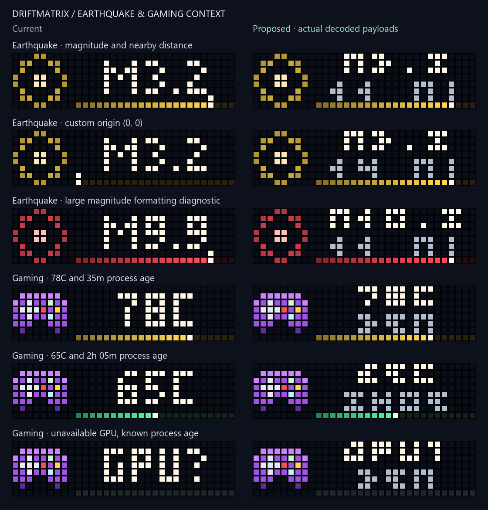

# Earthquake and gaming context

The earthquake page showed a magnitude and an unlabeled proximity rail, leaving
the actual distance in logs. Game Mode accepted session minutes but rendered only
GPU temperature. Both pages now keep two readings visible together in the existing
23-pixel lane, using two 3-pixel text rows, a blank separator and one bottom rail.



## Earthquake page

The top row shows magnitude (`M3.2`); the bottom shows distance (`14 MI`). Wider
distances drop the space, then use an explicit thousands-of-miles suffix (`KMI`).
The single proximity rail still fills as the epicenter gets closer, with the
existing magnitude severity colors. The old row-6 needle is removed so it cannot
overwrite the distance glyphs. Magnitudes are no longer silently capped at 9.9.
Large magnitude and antipodal samples in the gallery are formatting diagnostics.

The existing expanding shockwave icon is retained. Its still fallback holds a
legible ring pose and the exact same magnitude/distance bitmap. This is a pushed
page, not an added resident script.

The feed query, distance, proximity rail and log description now all use the same
configured origin. Optional paired fields are available in canonical Hub options:

```json
{
  "services": {
    "hub": {
      "enabled": true,
      "options": {
        "quakes": {
          "enabled": true,
          "latitude": 33.87529,
          "longitude": -117.56644,
          "radius_km": 150,
          "min_magnitude": 2.5
        }
      }
    }
  }
}
```

This is a configuration fragment for review. Omit both coordinates to retain the
existing location; supply both to choose another origin. Both loaders reject
unpaired, nonnumeric, nonfinite, boolean and out-of-range coordinates. Legacy
`utility_hub.json` uses the same fields inside its top-level `quakes` object.
Offline migration preserves the coordinates and their provenance while leaving
the imported worker disabled pending ownership review.

Malformed individual feed records are skipped without discarding valid neighbors.
A malformed feed root is treated as a fetch failure, preserving the existing page
until its normal lifetime expires. A valid empty feed still removes the page.
Existing event windows, selection, polling and pushed lifetime remain unchanged.

## Game Mode

GPU temperature stays on the top row (`78C`), with process age beneath (`35M` or
`2H05`). The sole rail continues to measure temperature against the existing
30–95C scale and severity bands. The existing shaded gamepad animation is retained;
its still fallback keeps the same two readings.

The age is elapsed time since the detected game process started. It includes
menus, loading and idle time; it is not a measurement of active play. Age is
calibrated from the creation timestamp when a process identity is first observed,
then advances using monotonic time so PC clock corrections cannot jump it forward
or backward. PID plus creation timestamp distinguishes a new process even when
Windows reuses a PID. Unknown or future start times show `AGE?`; ages at least
100 hours use the lower-bound label `99H+`. Whole minutes are rounded down.

Unavailable GPU readings show `GPU?` while retaining known process age. A GPU
reader exception no longer prevents this page from refreshing. Detection rules,
process scan interval, keepalive and removal when the game exits are retained.
This does not add FPS collection or a background play-history database.

## Review and verification

The self-contained `figures/alert-context/index.html` compares 13 illustrative
states, including custom origin, nearby/edge/global distance, long/unknown age and
missing GPU data. Baseline payloads were captured before product edits at
`42fbc98f8245c32880980f6be2aacdd7903c879d`. `manifest.json` records baseline and
normalized source hashes. Current animated and still frames are decoded from the
actual firmware-prepared payloads; the baseline had no separate safety variant.
Its frozen first frame is labeled as an inspection aid, not a deployed fallback.

Regenerate from the checkout:

```powershell
& 'C:/Users/devyn/anaconda3/python.exe' -X utf8 alert_context_preview.py --before figures/alert-context/before.json --baseline-revision 42fbc98f8245c32880980f6be2aacdd7903c879d --out figures/alert-context
```

The largest sampled request body is **1,640 bytes**, including current firmware's
image prefix and HTTP JSON spacing, below the 2,048-byte limit. Both pages retain
an 8×8 GIF icon and a 23×8 bitmap, a black column-8 gutter, the existing 120ms
animation beat, and their original app slots. Still fallbacks reach the existing
`PanelClient` safety latch through an optional `PresenceScene` argument; old scene
callers retain their original two-argument transport call.

Regression checks cover actual glyph/rail pixels, both configuration paths,
migration provenance, feed query coordinates, malformed records, monotonic age,
PID reuse, missing data, refresh pacing, page removal, failure/retry behavior,
real guarded/journaled static pushes and prepared HTTP body sizes without sending.
The built wheel's schema, origin mapping, labels and animated/still payloads were
also exercised outside the checkout. **2,971 local tests passed in 61.57 seconds**,
including 53 new cases, with no failures, errors or skips. CI results are recorded
in the pull request.

The rendered comparison was inspected. Browser interaction and screen-reader
acceptance remain unverified for this candidate. The earlier browser rejection of
a saved local HTML file was not worked around; this review uses decoded image
artifacts and offline tests. Physical 3-pixel glyph legibility remains a user
acceptance item before adoption.

No live configuration, host release, scheduled task, resident script or physical
clock was changed. Visual approval, fresh snapshot/rollback evidence and guarded
physical appearance and stability checks remain required. The wider overhaul
continues with Now Playing title/progress review, resident rollback support and
staged adoption.
