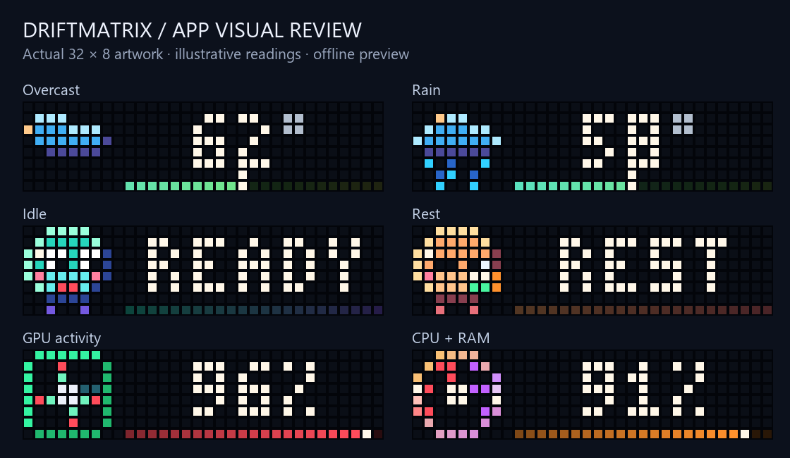

# App overhaul

The art and animation revision is in `ART_MOTION_REVISION.md`. It revises fourteen
host scenes and adds separate Ocean 3.1, Moon 2.3 and Now Playing 2.3 sources.
The earlier proposals remain comparison references. The new art is staged for
visual review; it has not been adopted into the running host or clock.

The active objective is to revise weak apps, improve functionality and add everyday
quality-of-life features. The user's first priority is **animations, layout and
visual polish**. This is broader than the first visual pass below.

## Acceptance requirements

- Inspect every currently enabled app family and preserve useful existing behavior.
- Make weak artwork readable at 32×8, with distinct silhouettes, intentional motion,
  clear values and no text/meter collisions. Keep static and low-light variants useful.
- Verify the actual exported payloads and frame timing, including current firmware
  encoding, rather than relying only on simulated source art.
- Improve weak functionality and everyday controls, including configuration awareness,
  command feedback/recovery and the installed launch path.
- Keep changes reviewable in GitHub. Review visual previews before live adoption.
- Preserve guarded transport, source/config/task rollback, Nightkeeper policy and
  the panel's constrained memory budget. Any physical deployment requires a fresh
  snapshot and post-deployment verification, with physical appearance kept separate.

## Evidence and progress

The October 26 read-only check found the pinned 1.2.2 host healthy with all five
workers running and no automatic worker restarts. The clock had about 100 minutes
uptime, no resident script errors and a 34,804-byte largest free block. All six CI
jobs for firmware compatibility passed. These are observations, not long-term proof.

| Workstream | Current evidence | Remaining work |
| --- | --- | --- |
| Weather | Rounded cloud edges and layered overcast; rain advances without white drop flashes. Animated/static previews measured. | Review the full condition family; adopt a suitable motion policy after staged panel verification. |
| PC stats | GPU rotor poses plus a dedicated receive readout: explicit MiB/s/GiB/s, simultaneous value/unit, packet motion, configurable visual scale and hardware-first alert priority. See `NETWORK_OVERHAUL.md`. | User review of the two-row layout, browser acceptance and guarded host/physical adoption. |
| Desk Companion | Cleaner round silhouette, 120 ms blink, unchanged 1.92 s cycle and five mood props. | User visual review, then staged host adoption and physical appearance check. |
| AQI | Existing six category designs retained as reference. Live service is explicitly static. | Review category legibility, severity pacing and whether animation should be enabled. |
| Moon / Ocean | Installed sources preserved. Ocean 3.0 and Moon 2.2 have separate visual candidates. Explicit legacy identity, exact snapshots and guarded rollback/resume support are implemented in `LEGACY_SCRIPT_IDENTITY.md`. | User visual review, fresh live identity/maintenance validation, then guarded memory/FPS and physical adoption checks. |
| Now Playing / information apps | Calendar, timers and alert context have staged candidates. Separate Now Playing 2.2 preserves normal title scrolling, clears the gutter, bounds record motion and adds optional held reduced-motion cards. See `INFORMATION_OVERHAUL.md`, `ALERT_CONTEXT_OVERHAUL.md` and `NOW_PLAYING_OVERHAUL.md`. | User visual review, device memory/FPS and physical adoption gates. |
| Everyday controls | Canonical-aware `driftmatrix controls`, custom Focus/snooze durations, persistent feedback and local service overview are implemented. Focus commits state before queue acknowledgement. PR #10 passed 6/6 CI. See `docs/desk-controls.md`. | User review, then guarded host-release adoption. Screen-reader acceptance is unverified. |

## First visual pass

13 updated scenes within a 26-scene comparison set: seven weather states, five
companion moods and GPU activity. Other scenes are explicit reference designs.
Readings, text, numeric rails and scheduling are unchanged in this pass. Live
weather and AQI still use `static_only: true`; the animation preview does not claim
that the deployed configuration already animates these feeds.



Download/open `figures/app-overhaul/index.html` for the self-contained comparison.
It includes category filters, updated-scenes filtering, pause/play, 120 ms stepping,
real static fallback payloads, low-light threshold view and current firmware wire sizes.
The baseline was captured before source edits; lane hashes separately protect values
and layout. The gallery requires no network or device access.

Regenerate from the repository root:

```powershell
& 'C:/Users/devyn/anaconda3/python.exe' -X utf8 led_redesign_preview.py --before figures/app-overhaul/before.json --out figures/app-overhaul
```

Validation: **2,757 tests passed in 54.42 seconds**, including 31 new checks. Maximum
animated wire size is **1,912 bytes** against the 2,048-byte limit. Browser interaction
checks covered filtering, pause, stepping, static fallback and low-light selection.
Desktop gallery rendering was inspected. Narrow viewport, screen-reader behavior,
physical LEDs and post-deployment stability have not been verified for this pass.

No live scripts, configuration or scheduled tasks were changed by this visual pass.
The overall overhaul remains active; this first batch does not complete it.

## Ocean candidate follow-up

`ocean-v3.ax` is a separate candidate; the installed-source reference `ocean.ax`
is unchanged. The source-executed 30-second preview and lifecycle tests are in
`OCEAN_OVERHAUL.md`. This follow-up improves encounter visibility and hidden-time
behavior without adding more scene elements. Its actual total VM heap use,
real device heap/FPS and physical acceptance still require verification.

## Moon candidate follow-up

`weather/moon-panel-v2.2.ax` leaves the installed 2.1 reference unchanged. Its
source-executed comparison covers four illustrative phases and an unsynced manual
activation. Native width measurements protect the information layout; the preview
font remains a model. See `MOON_OVERHAUL.md` for the 33 checks and deployment gates.

## Desk Controls follow-up

The desktop candidate uses canonical configuration and packages the previously
missing GUI modules. It preserves standalone legacy selection and adds an isolated
demo. Custom durations, status-aware actions, durable command receipts and the
Services tab address the everyday-control audit findings. Read-only status checks
and demo interaction do not constitute deployment of the candidate host release.
The broader app overhaul and physical visual review remain active.

## Information follow-up

Eight changed screens in a 30-scene actual-payload corpus restore calendar event
identity and correct long Focus/reminder readings. The installed runtime and
offline browser review are verified in `INFORMATION_OVERHAUL.md`. This audit also
confirmed a NET unit bug and information gaps in earthquake/gaming pages; those
remain follow-ups rather than being hidden behind the reference artwork label.

## Receive-throughput follow-up

The NET unit/capping defect is corrected in the staged network candidate, including
the real sender's update detector and supervised settings. Fourteen actual-payload
comparisons cover large rates and competing hardware alerts. The full suite passes
2,918 tests. Earthquake/gaming context is addressed in the follow-up below;
Now Playing review, resident rollback support and visual/physical adoption remain.

## Earthquake and gaming context follow-up

Two held rows restore explicit earthquake distance and game-process age. The
earthquake origin reaches both the feed query and all display/log calculations;
game age advances monotonically after initial process observation. Both pages
now provide real still fallbacks to the existing guarded transport. Thirteen
actual-payload comparisons cover ordinary, missing-data and formatting states.
See `ALERT_CONTEXT_OVERHAUL.md`. Physical glyph legibility and candidate adoption
remain open acceptance items.

## Now Playing follow-up

The separate 2.2 candidate keeps the existing title scroller while correcting the
gutter, bounding visible record motion and clearing outgoing stale titles. An
optional canonical reduced-motion mode holds complete glyph cards with a still
record and progress leader. The four-state source-executed comparison covers full
visits, with explicit JSON/HTTP model boundaries and raw/minified parity checks.
The installed 2.1 reference and default selection are preserved. See
`NOW_PLAYING_OVERHAUL.md`; actual VM cost and physical readability remain open.

## Legacy identity and recovery follow-up

The older versionless Ocean can now be handled through an explicit two-pin
contract. The tool verifies current source bytes under the shared mutation gate
before writes, checks exact snapshot bytes and binds resume/recovery to the full
source identities. The original reference is unchanged. Fake-panel tests include
the real Ocean files and execution of the generated failure-recovery recipe.
This enables review of adoption tooling; live identity, maintenance-policy
selection, visual approval and physical acceptance remain separate requirements.

## Canonical swap maintenance follow-up

The staged swap tool now uses the canonical Hub mapping, runtime state directory
and actual host-local maintenance clock. It records selection provenance, rejects invalid selected
files, checks the selected local supervisor identity and rereads policy/history
before dispatch. Configuration changes after a partial swap pause recovery until
the new policy is reviewed. See `CANONICAL_SWAP_MAINTENANCE.md`. This completes the
selection implementation gap; current live identity, competing-process checks,
visual review, memory validation and guarded physical adoption remain open.
