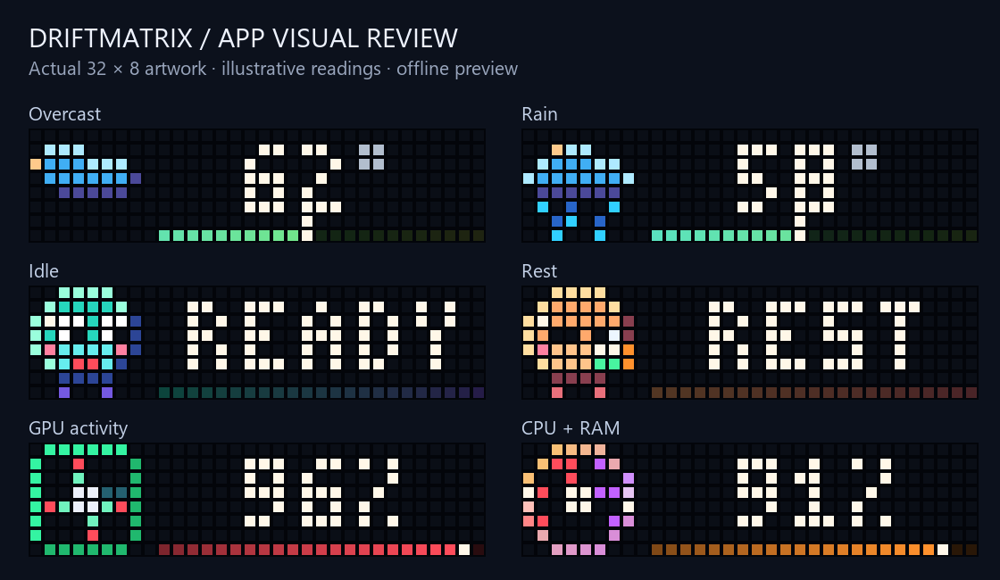

# App overhaul

This is the source-review roadmap for the app overhaul. Design references and
later compact candidates are retained together; source review, guarded host/device
adoption and physical acceptance are separate records. The art direction approved
on 2026-10-28 is documented in `ART_MOTION_REVISION.md`; later weather/AQI palette
and animation choices are documented in their own reviews.

Actual-worker acceptance is documented in `HOST_FLEET_ACCEPTANCE.md`. The combined
run found and fixes a cold-start image-format gap before the first health probe.
The real five-worker process/HTTP/state lifecycle is now checked in the checkout
and installed runtime, with native providers and feeds supplied by explicit
fixtures. It does not constitute live adoption or physical acceptance.

The active objective is to revise weak apps, improve functionality and add everyday
quality-of-life features. The user's first priority is **animations, layout and
visual polish**. This is broader than the first visual pass below.

## Acceptance requirements

- Inspect every currently enabled app family and preserve useful existing behavior.
- Make weak artwork readable at 32×8, with distinct silhouettes, intentional motion,
  clear values and no text/meter collisions. Keep static and low-light variants useful.
- Verify the actual exported payloads and frame timing, including current firmware
  encoding, rather than relying only on simulated source art.
- Improve weak functionality and everyday controls, including configuration awareness,
  command feedback/recovery and the installed launch path.
- Keep changes reviewable in GitHub. Review visual previews before live adoption.
- Preserve guarded transport, source/config/task rollback, Nightkeeper policy and
  the panel's constrained memory budget. Any physical deployment requires a fresh
  snapshot and post-deployment verification, with physical appearance kept separate.

## Current source-review coverage

This table describes code and review artifacts, not a live-host inventory. Read
current configuration, process state, device identity and private rollback evidence
before adoption. Design approval does not establish physical pixel appearance.

| Workstream | Current source evidence | Acceptance boundary |
| --- | --- | --- |
| Weather | Original pre-revamp animations restored; documented provider-code routing, wet forecast semantics and unknown-condition handling. See `WEATHER_CONDITIONS.md`. | Review the selected version; actual delivery, memory, physical appearance and motion policy require runtime evidence. |
| PC stats / NET | GPU motion plus explicit MiB/s/GiB/s receive readings, configurable visual scale and hardware-first alert priority. See `NETWORK_OVERHAUL.md`. | Native sampling, alert activation and physical two-row readability remain distinct from fixture rendering. |
| Desk Companion | Shaded shell, breathing, wave, brief blink and mood props. See `ART_MOTION_REVISION.md`. | Actual selected mood and physical legibility need runtime/user evidence. |
| AQI | Restored paired lungs, consistent palette, explicit full-size AQI label through three digits and preserved relevance policy. See `AQI_READABILITY.md`. | An enabled worker may intentionally hide good-air readings; physical animation is separate from delivery/config state. |
| Moon / Ocean | Compact Moon 2.4 and Ocean 3.3 source candidates preserve reviewed art; Ocean restores teal water, green kelp and olive reef. See `MOON_COMPACT.md`, `OCEAN_COMPACT.md`, `OCEAN_PALETTE.md`. | Exact source identity, shared VM ceiling, lit drawing/performance and physical acceptance are separate gates. |
| Now Playing | Compact 2.4 source, held reduced-motion cards, readable title/progress behavior and private media activity/recovery. See `MEDIA_COMPACT.md`, `MEDIA_ACTIVITY.md`. | Local playback detection does not prove the clock fetched/displayed it; real lit playback and physical acceptance remain separate. |
| Calendar / timers / alerts | Held event identity/ETA cards, long timer labels, quake distance and gaming process age. See `INFORMATION_OVERHAUL.md`, `ALERT_CONTEXT_OVERHAUL.md`. | Calendar needs a configured source; synthetic alert examples are not live events or proof of provider availability. |
| Everyday controls | Canonical paths, custom Focus/snooze durations, durable receipts, host/worker activity and calendar setup explanation. See `docs/desk-controls.md`, `FEED_ACTIVITY.md`, `CALENDAR_SETUP_STATUS.md`. | Use matching host/controls source and the intended shortcut. Feed/setup explanations require current matching configuration and confirmed process state. |

The dated development entries below describe their then-current state. Later
review documents supersede their candidate versions and pending-work lists. They
must not be used to infer which release or motion policy is running now.

## Historical first visual pass


13 updated scenes within a 26-scene comparison set: seven weather states, five
companion moods and GPU activity. Other scenes are explicit reference designs.
Readings, text, numeric rails and scheduling are unchanged in this pass. Live
weather and AQI still use `static_only: true`; the animation preview does not claim
that the deployed configuration already animates these feeds.



Download/open `figures/app-overhaul/index.html` for the self-contained comparison.
It includes category filters, updated-scenes filtering, pause/play, 120 ms stepping,
real static fallback payloads, low-light threshold view and current firmware wire sizes.
The baseline was captured before source edits; lane hashes separately protect values
and layout. The gallery requires no network or device access.

Regenerate from the repository root:

```powershell
& 'C:/Users/devyn/anaconda3/python.exe' -X utf8 led_redesign_preview.py --before figures/app-overhaul/before.json --out figures/app-overhaul
```

Validation: **2,757 tests passed in 54.42 seconds**, including 31 new checks. Maximum
animated wire size is **1,912 bytes** against the 2,048-byte limit. Browser interaction
checks covered filtering, pause, stepping, static fallback and low-light selection.
Desktop gallery rendering was inspected. Narrow viewport, screen-reader behavior,
physical LEDs and post-deployment stability have not been verified for this pass.

No live scripts, configuration or scheduled tasks were changed by this visual pass.
The overall overhaul remains active; this first batch does not complete it.

## Ocean candidate follow-up

`ocean-v3.ax` is a separate candidate; the installed-source reference `ocean.ax`
is unchanged. The source-executed 30-second preview and lifecycle tests are in
`OCEAN_OVERHAUL.md`. This follow-up improves encounter visibility and hidden-time
behavior without adding more scene elements. Its actual total VM heap use,
real device heap/FPS and physical acceptance still require verification.

## Moon candidate follow-up

`weather/moon-panel-v2.2.ax` leaves the installed 2.1 reference unchanged. Its
source-executed comparison covers four illustrative phases and an unsynced manual
activation. Native width measurements protect the information layout; the preview
font remains a model. See `MOON_OVERHAUL.md` for the 33 checks and deployment gates.

## Desk Controls follow-up

The desktop candidate uses canonical configuration and packages the previously
missing GUI modules. It preserves standalone legacy selection and adds an isolated
demo. Custom durations, status-aware actions, durable command receipts and the
Services tab address the everyday-control audit findings. Read-only status checks
and demo interaction do not constitute deployment of the candidate host release.
The broader app overhaul and physical visual review remain active.

## Information follow-up

Eight changed screens in a 30-scene actual-payload corpus restore calendar event
identity and correct long Focus/reminder readings. The installed runtime and
offline browser review are verified in `INFORMATION_OVERHAUL.md`. This audit also
confirmed a NET unit bug and information gaps in earthquake/gaming pages; those
remain follow-ups rather than being hidden behind the reference artwork label.

## Receive-throughput follow-up

The NET unit/capping defect is corrected in the staged network candidate, including
the real sender's update detector and supervised settings. Fourteen actual-payload
comparisons cover large rates and competing hardware alerts. The full suite passes
2,918 tests. Earthquake/gaming context is addressed in the follow-up below;
Now Playing review, resident rollback support and visual/physical adoption remain.

## Earthquake and gaming context follow-up

Two held rows restore explicit earthquake distance and game-process age. The
earthquake origin reaches both the feed query and all display/log calculations;
game age advances monotonically after initial process observation. Both pages
now provide real still fallbacks to the existing guarded transport. Thirteen
actual-payload comparisons cover ordinary, missing-data and formatting states.
See `ALERT_CONTEXT_OVERHAUL.md`. Physical glyph legibility and candidate adoption
remain open acceptance items.

## Now Playing follow-up

The separate 2.2 candidate keeps the existing title scroller while correcting the
gutter, bounding visible record motion and clearing outgoing stale titles. An
optional canonical reduced-motion mode holds complete glyph cards with a still
record and progress leader. The four-state source-executed comparison covers full
visits, with explicit JSON/HTTP model boundaries and raw/minified parity checks.
The installed 2.1 reference and default selection are preserved. See
`NOW_PLAYING_OVERHAUL.md`; actual VM cost and physical readability remain open.

## Legacy identity and recovery follow-up

The older versionless Ocean can now be handled through an explicit two-pin
contract. The tool verifies current source bytes under the shared mutation gate
before writes, checks exact snapshot bytes and binds resume/recovery to the full
source identities. The original reference is unchanged. Fake-panel tests include
the real Ocean files and execution of the generated failure-recovery recipe.
This enables review of adoption tooling; live identity, maintenance-policy
selection, visual approval and physical acceptance remain separate requirements.

## Canonical swap maintenance follow-up

The staged swap tool now uses the canonical Hub mapping, runtime state directory
and actual host-local maintenance clock. It records selection provenance, rejects invalid selected
files, checks the selected local supervisor identity and rereads policy/history
before dispatch. Configuration changes after a partial swap pause recovery until
the new policy is reviewed. See `CANONICAL_SWAP_MAINTENANCE.md`. This completes the
selection implementation gap; current live identity, competing-process checks,
visual review, memory validation and guarded physical adoption remain open.

## Host adoption and remaining resident budget

The revised art direction was approved on October 28. Pinned host release
`d9a90cd798a2` was adopted with fresh snapshots, exact resident readbacks,
preserved configuration/state and five healthy workers. The user confirmed its
normal rotation “Looks normal and readable.” Weather/AQI retain static safety
settings; Ocean, Moon and Now Playing retain their previous resident sources.

The next resident safeguard enforces the existing 75% shared VM policy before
PUT and after the verification reboot, including already-installed, resumed and
check-only paths. Missing or over-ceiling measurements cannot accept a new set;
recovery can still restore the previous source with its memory status reported.
See `RESIDENT_VM_BUDGET.md`. This tooling change does not install a resident
candidate or establish its real compiled cost, FPS or physical appearance.

## Ocean allocation follow-up

The guarded 3.1 hardware trial measured 25,313 bytes for Ocean and 80,604 bytes
shared, rejected it and restored the previous source and rotation. The separate
3.2 candidate consolidates visitor state, packs exact numeric data and releases
one-time constructor constants. Its float32 source comparisons preserve the
approved art and lifecycle. The independent upstream runtime profile shows
lower retained allocation but does not establish ESP32 fit; all live memory,
rollback, FPS and physical gates remain. See `OCEAN_COMPACT.md`.

## Moon allocation follow-up

The separate `weather/moon-panel-v2.4.ax` source packs exact numeric/colour data,
nebula runs and disc rows, then retires its one-time constructor. Source execution
preserves the approved 2.3 art, astronomy, label timing and lifecycle: 47 new
regression cases and 550 identical saved frame pairs. The full suite passes 3,332
tests. An upstream Berry profile shows reduced retained allocation but does not
establish ESP32 fit. The installed Moon reference is unchanged and all live
memory, identity, maintenance, rollback and physical gates remain. See
`MOON_COMPACT.md`. Ocean 3.2 is installed with memory and live drawing evidence;
the user missed its physical test, so that acceptance remains pending.

## Now Playing allocation follow-up

The separate 2.4 source packs glyphs, title columns, signed card entries and full
RGB progress data, then releases one-time constructor constants. Approved art,
scrolling, reduced-motion cards and lifecycle behavior match in source execution,
including maximum-length titles and signed card sentinels. The new sibling
resource is packaged; real fleet acceptance covers both 2.3 and 2.4 in both motion
modes. Upstream execution confirms a lower retained cost and matching framebuffers
but cannot establish ESP32 fit or physical appearance. Defaults and installed
sources are unchanged. See `MEDIA_COMPACT.md`; live adoption gates remain.


## Ocean physical colour correction

The user reported that Ocean 3.2 now looked entirely blue. Live source/read-only
framebuffer inspection confirmed the deployed identity and a blue-dominant palette;
the art revision had replaced the original green/olive environment with blue-grey.
The separate 3.3 candidate restores original water, kelp, bubble and reef colours
while preserving the newer visitors, motion and compact storage. See
`OCEAN_PALETTE.md`. The user approved the restored palette preview on October 29. Guarded
installation and physical colour verification remain.


## Restored AQI lungs and explicit readings

The requested AQI revision restores the preserved paired-lung silhouette and
four-pose breath, replacing wind comets and the multicolour treatment with a
consistent mint/pearl icon, neutral label and single-hue rail. Three-digit
readings retain the explicit AQI label with full-size glyphs and one black
column of separation. The current value, meter position, relevance, metadata,
quiet hours and static recovery path remain protected; other app payloads are
unchanged. See `AQI_READABILITY.md` for actual-payload comparisons, the original
breath cadence and low-light/static views. The restored design must be reviewed
before guarded host adoption, including the requested AQI animation; physical
appearance remains separate. This follow-up makes no live changes.


## Weather condition routing and animation restoration

Exact documented-code routing preserves current/forecast semantics and stops
unassigned codes from inventing precipitation. Following the user's rejection of
the new symbols and preference for the old animations, weather artwork is restored
from the original pre-revamp source, including cloud colours, moving highlights
and the original five-stream rain cycle. Freezing precipitation shares the familiar
rain animation; unknown conditions keep the valid temperature with a blank icon.
Historical frame hashes and timing protect the restoration. See
`WEATHER_CONDITIONS.md` for actual-payload previews and verification. The user approved the restored original preview on October 31, 2026. Guarded
host/motion adoption and physical acceptance remain separate. This source revision
makes no live changes.


## Feed visibility and retry explanations

The next controls candidate distinguishes a healthy feed process from its page
activity. Structured Weather/AQI reports explain successful delivery, existing
good-air hiding and upstream/clock retries without parsing log text or polling
the clock from the UI. Timestamp expiry, child-bound IPC and restart reset prevent
old success from appearing current. The native isolated Services preview and
verification scope are in `FEED_ACTIVITY.md`. The running host and shortcut are
unchanged by this source implementation; guarded adoption remains separate.


## Now Playing status and disconnect recovery

The media follow-up explains idle/playing, inactive grace, setup retries and
Windows-provider failures through owned worker activity. It keeps track metadata
out of status and distinguishes local producer readiness from clock delivery.
Expected broken-pipe/reset/abort clients no longer create server tracebacks;
unexpected failures keep normal error reporting, and real HTTP recovery tests
require the next request to succeed. Local status reads gain bounded retries for
brief permission denial while retaining strict record/identity checks. See
`MEDIA_ACTIVITY.md`. No resident artwork
or live host setting is changed by this source proposal. Physical lit playback
and guarded host/controls adoption remain separate.


## Calendar setup visibility

The read-only Services candidate explains when Next Up is enabled without any
calendar source. It derives the hint from the validated selected configuration
and shows it only with a healthy, matching host and confirmed Hub process. It
never selects a calendar, fetches a feed, changes enablement or restarts the host.
See `CALENDAR_SETUP_STATUS.md` for the native demo and scope.

## Focus timing follow-up

The break steam and completion GIFs used off-grid delays despite the established
120 ms timing rule. `FOCUS_TIMING.md` compares the actual old/new wire payloads:
unchanged art and timer lanes, slightly slower steam, and a longer one-shot cue.
This remains a separate source candidate pending visual approval and guarded host
adoption; it is not evidence that a physical clock already displays the change.
