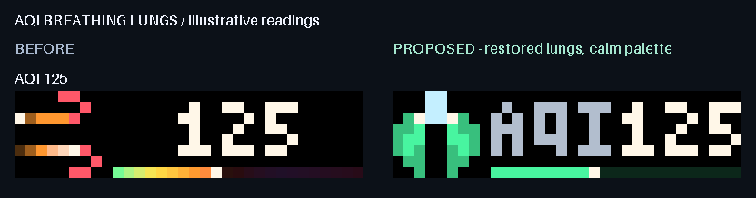
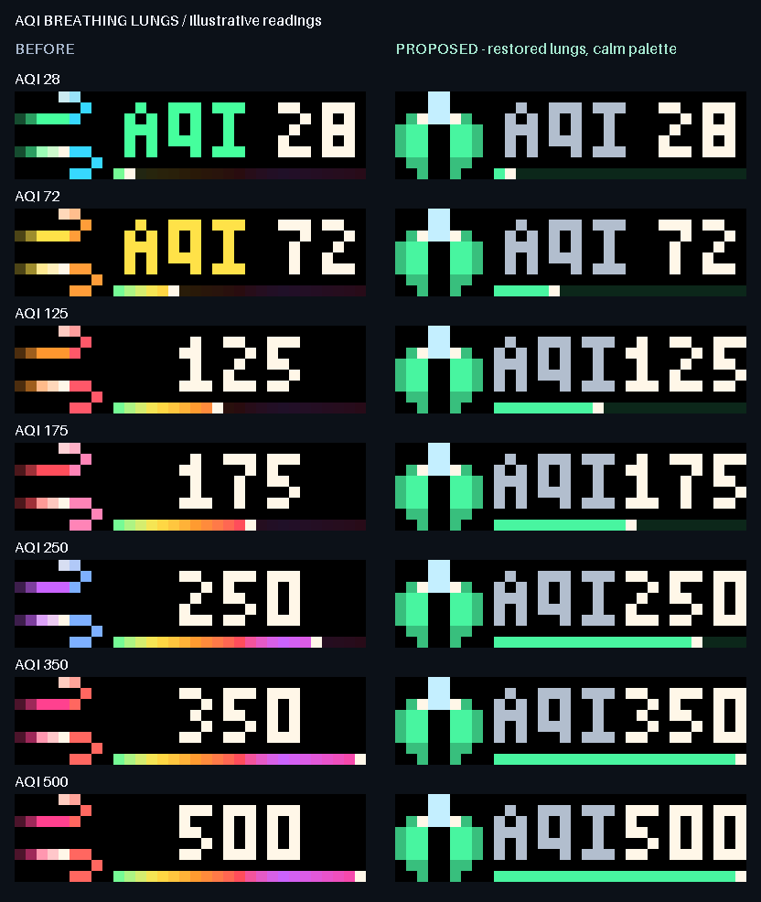

# Restored breathing lungs and explicit AQI readings

The AQI revision restores the earlier paired-lung artwork and four-pose
inhale/exhale animation. The lungs, Y-shaped airway and connected internal
highlights come from the preserved `draw_lungs_jewel` renderer. A single mint
body, cool airway and pearl accents replace the multicolour wind treatment.
The label is neutral and the meter uses one mint hue; it no longer grades
through a rainbow. The current numeric AQI remains explicit at every reading.



## Motion and palette

The four poses follow the preserved resting, inhaling, full and exhaling
sequence; the middle inhale/exhale frames match. The occupied silhouette stays
whole while highlights move inside the lobes. The stable Y-shaped airway remains
visible throughout. Static fallback holds a complete middle-breath pose.

The earlier severity-dependent cadence is restored: 720, 600, 600, 480, 480 and
360 ms per pose across the existing six categories. Every delay is on the
120 ms beat. Category affects breathing pace, not the palette or geometry.
The GIF remains an opaque 8-by-8 icon; the information lane is static and no
per-frame HTTP request is introduced.

The preserved preview helper accepts an optional colour override; its default
historical category rendering is unchanged. The production sender explicitly
selects the consistent mint palette. Existing relevance, category boundaries,
forecast handling, alert thresholds, lifetime, quiet hours and safety fallback
logic are retained.



## Explicit identity and full-size readings

Previously the normal AQI label/value run needed 25 pixels for three digits,
but the lane is 23 pixels. The label disappeared, leaving a generic icon and a
number. The proposed lane keeps the established 3-by-5 AQI and numeric glyphs:
11 pixels for AQI, one black column and 11 for three digits. Shorter readings
retain their three-pixel gap and placement. The label now uses neutral ink.
The numeric glyphs, black icon separator and row-six clearance are preserved.
The meter's leader retains the exact previous value/rounding position.

`render_rich_lane` gains an explicit positive-integer `label_gap` option with
its existing three-pixel default. AQI alone selects compact spacing. A label
that still cannot fit yields to the complete value, as before. The current
rounding/clamping policy remains, including the existing 500 display cap.

Sampled prepared firmware-1.2.2 payloads reach **1,257 bytes**, below 2,048 bytes.
They are 24-368 bytes smaller than the corresponding old static/animated bodies.
This source change does not select a live host release or alter live settings.
Guarded adoption must include the requested AQI icon animation while retaining
the sender's real static recovery path.

## Reproducible review

The [self-contained interactive review](docs/aqi-reading/index.html) covers 19
illustrative readings, every category and boundary values. It supports original
per-case timing, actual static fallback, 120 ms stepping, changed-only filtering
and the existing low-light threshold view. Examples are not live measurements.
The representative AQI 125 movie covers its complete 2.4-second breath cycle
and round-trips exact RGB frames through a 45-colour palette. The
[low-light sheet](docs/aqi-reading/lungs-low-light.png) uses the established per-channel
174 threshold; it does not model gamma, diffusion or physical LEDs.

With the project's Python environment activated:

```console
python -X utf8 aqi_reading_review.py --output figures/aqi-reading
```

`docs/aqi-reading/before.json` freezes pre-change prepared payloads at
`617689cea289310de672e53e78b65eebe706b22f`, including 38 AQI and 40 other-page
static/animated cases. The manifest records source/baseline hashes, exact
current wire payloads, frame fingerprints, sizes, timings and limits; the HTML
contains full decoded RGB frames.

## Verification and adoption

Thirty-three new cases cover all 501 readings in both motion modes, complete
label/value masks, black clearances, low-light text, fixed lung geometry,
consistent colour across categories, the four-pose breath and unchanged
relevance/lifetime metadata and meter position. Forty other weather, Companion
and PC payloads remain byte-exact. Existing lung-reference tests still protect
the original helper output; sender tests now assert lung motion and a single-hue
rail. Six AQI whole-lane expectations are intentionally updated against an
independent glyph/meter oracle, retaining their original hashes.

The revised focused sender/layout/gallery run passed 103 tests. The full suite
passed **3,472 tests in 137.22 seconds**, with zero failures, errors or skips.
An isolated wheel contains all three matching sender/renderer/helper sources;
eight boundary/motion cases passed outside the checkout with HTTP blocked. CI
results are recorded in the pull request. No live
clock, host, configuration, task or service change was performed by this work.
The restored animation and palette need preview review, then fresh snapshot,
guarded host adoption with bounded AQI animation and physical legibility checks.
The overall app overhaul remains active.
