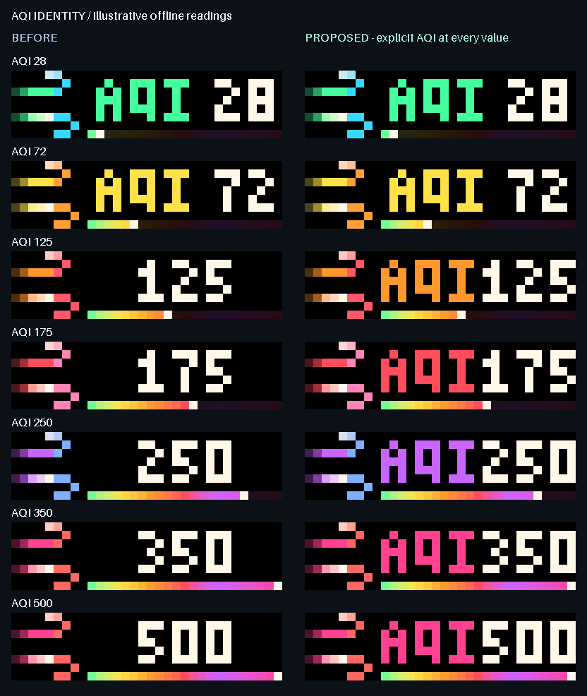
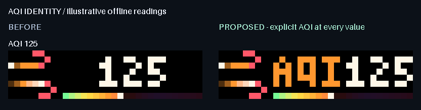

# Explicit AQI readings through three digits

The existing AQI sender drops its label when a reading reaches three digits.
The normal label/value run needs 25 pixels, but the information lane is 23 pixels.
The remaining wind icon is generic, so a reading such as 125 loses its explicit
AQI identity precisely where its context matters most.

The proposed layout retains the established 3-by-5 AQI and numeric glyphs.
For 100 through the existing display cap of 500, an 11-pixel AQI label, one black
column and 11 pixels of digits occupy the exact 23-pixel lane. Readings below
100 retain their original three-pixel gap and byte-identical placement. No
smaller font, scrolling label, alternating information row or additional page is
needed.



## Scope and preservation

`render_rich_lane` gains an explicit positive-integer `label_gap` option, with
its existing three-pixel default. An optional label that still cannot fit yields
to the complete value, as before. AQI alone selects the one-pixel gap for three
digits. The caller's existing rounding/clamping and category selection remain.

The actual GIF bytes, category colours, rail pixels, value glyphs, black icon
separator, row-six clearance, duration/lifetime metadata, fetching, relevance,
alerts and fallback policy are unchanged. The prepared AWTRIX NG 1.2.2 bodies
retain exactly the same byte sizes; the sampled maximum is **1,625 bytes** against
the 2,048-byte limit. This change neither enables feed animation nor selects a
new live host release.



## Review and reproduction

The self-contained [interactive review](docs/aqi-reading/index.html) compares 19
illustrative readings across all six existing categories and their boundary
values. It supports animation, the actual static fallback, 120 ms stepping,
changed-only filtering and the existing low-light channel-threshold view.
These are illustrative inputs, not local air-quality measurements.

The static sheet covers all six categories plus the 500 cap. The representative
125 animation preserves its complete 2.4-second cycle. Its encoded GIF uses an
exact 40-colour palette; decoded output is compared back to every expected RGB
frame and the total timeline. The HTML preserves each case's actual timings.
The [low-light sheet](docs/aqi-reading/low-light.png) uses the established
per-channel threshold of 174; it does not model gamma, diffusion or physical LEDs.

With the project's Python environment activated:

```console
python -X utf8 aqi_reading_review.py --output figures/aqi-reading
```

`docs/aqi-reading/before.json` freezes prepared pre-change payloads at
`617689cea289310de672e53e78b65eebe706b22f`, including 38 AQI and 40 other-page
static/animated cases. The manifest records baseline/source hashes, exact current
payloads, frame fingerprints, timings, wire sizes and model limits. The self-contained
HTML retains the complete decoded RGB frames.

## Verification and adoption boundary

Twenty-seven new cases verify all 501 readings in both static and animated
modes, independently checking complete AQI/value glyph masks, spacing and
clearances. Frozen output comparisons protect icons, exact rail colours,
metadata, short AQI readings and 40 other weather/companion/PC page payloads.
The four three-digit AQI whole-lane contracts are intentionally updated against
an independently assembled glyph/old-rail oracle; their original hashes remain
in the contract fixture. Category-boundary checks protect low-light text masks. Shared-renderer tests
cover invalid geometry and the existing optional-label fallback.

The focused sender/shared-renderer run passed 73 tests. The full suite passed
**3,466 tests in 143.73 seconds**, with zero failures, errors or skips. An isolated
wheel was built and installed outside the checkout with no downloads. With HTTP
blocked, both installed source files matched the checkout and eight boundary/motion
payload cases retained their labels. CI results are recorded in the pull request. No live host, clock, configuration, task,
brightness, source installation or service change was performed by this work.
The proposed tighter layout requires user preview approval, followed by a fresh
snapshot, matching host release, guarded transport and physical legibility checks
before adoption. The overall app overhaul remains active.
