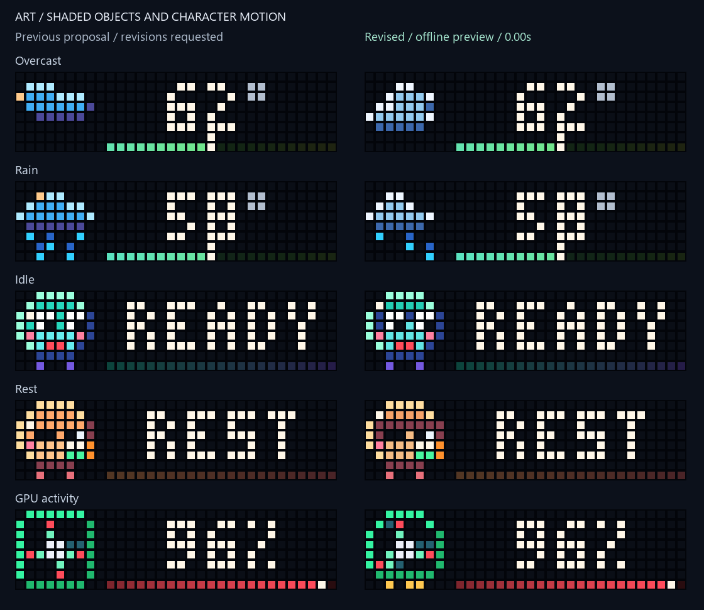
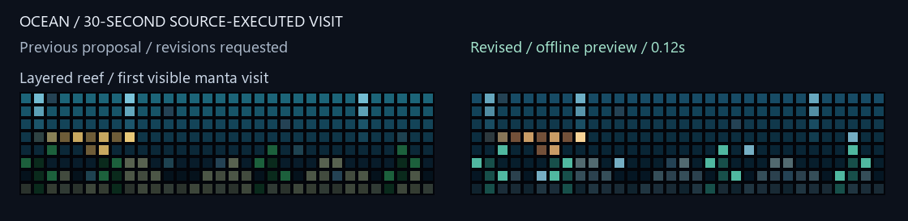
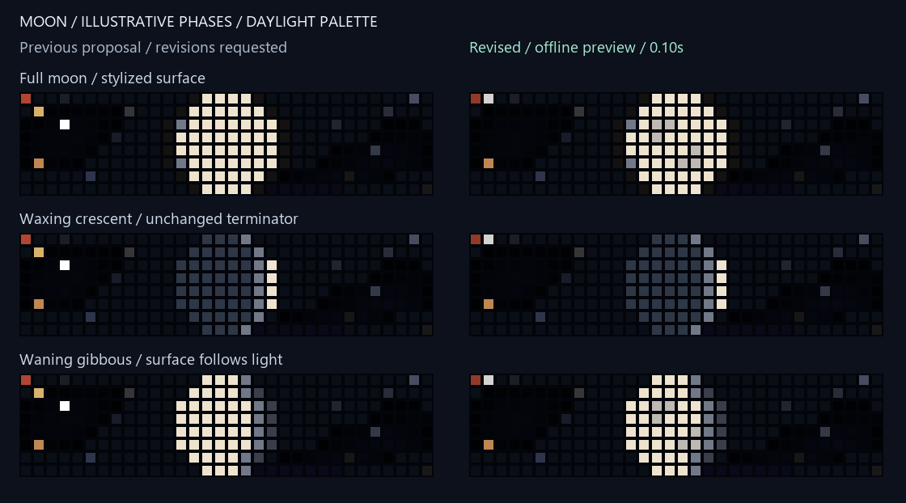
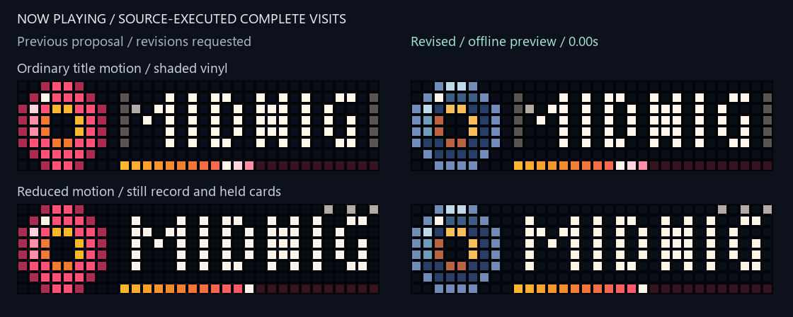

# Art and animation revision

The user approved this revised visual direction on 2026-10-28. Live adoption
still requires fresh snapshot/source identity, rollback, memory and physical
verification. Approval is not a claim that these candidates are installed.

This candidate gives the staged artwork stronger object shading and more
deliberate movement. Each comparison shows the previous proposal on the left and
the revision on the right. Neither side is a new observation of the clock.

## Pushed artwork



- Cloud banks have a white lit crown, blue body and darker underside. Cloudy and
  overcast banks drift one cell and settle back without wrapping or clipping.
- Rain has three spaced, staggered streams with black separation. Cloud lighting
  stays attached to the upper-left surface.
- The Companion has a dark faceplate, shaded colored shell, breathing and a small
  idle wave. Mood props, brief blink, glances and the 1.92-second cycle remain.
- The GPU has a rounded shroud, fixed gold contacts and three swept blades.
  Six distinct poses advance in one direction and meet at the loop seam. Load
  color remains on the moving tips; readings and meter pixels remain unchanged.

Fourteen host scenes change in the existing 26-scene actual-payload corpus.
Other scenes remain references. The 5.76-second comparison contains whole cloud,
Companion and GPU cycles and uses actual exported GIF durations.

## Resident candidates



`ocean-v3.1.ax` adds a diamond-shaped manta body, broad shoulders, raised/lowered
wingtips and a thin tail. Three wing positions follow six eased timing phases.
Deeper blue water, gold fish and brighter teal kelp separate objects from the
layered reef. Existing encounter scheduling, visible-time lifecycle and packed
light caches remain. The comparison executes the first 30-second visit.



`weather/moon-panel-v2.3.ax` adds six stylized surface markings only on the lit
side of the unchanged terminator. They are decorative maria, not a lunar map.
The meteor follows a 960 ms path with fade-in/out rather than a 300 ms flash.
The nebula color blend turns around continuously instead of resetting at
40 seconds. The comparison shows three illustrative phases over an 11-second
visit in the daylight palette. Percentage/card layout and astronomy are retained.



`now_playing-v2.3.ax` uses a cool reflective rim, dark grooves and a warm two-tone
label. Its highlight visits all 16 adjacent groove positions at a minimum 120 ms
per completed visible draw; slow frames cannot skip positions. Reduced motion
keeps the whole record still. Title/progress/card pixels and exit behavior match
the 2.2 candidate. The movie shows ordinary and reduced-motion visits and labels
their completion explicitly.

The 2.1 installed-source references, earlier candidate files and default media
template are retained. This change does not select a new template or enable live
Weather/AQI animation.

## Verification and resource limits

**3,163 local tests passed in 64.79 seconds**, including **30 new cases**, with
zero failures, errors or skips. Coverage includes bounded cloud geometry, rain
spacing, Companion expression/wave, fixed GPU shell/contacts, adjacent vinyl poses,
exact media lane/exit parity, reduced/hidden motion, lit-side-only Moon texture,
palette continuity, meteor fade, manta depth/wing steps, hidden-time preservation,
source-size limits and raw/minified execution parity. The existing source-cap
test caught an oversized Moon draft; the final source fits the unchanged limit.

| Candidate | Minified bytes | Required install block, 3.5x |
| --- | ---: | ---: |
| Ocean 3.1 | 11,007 | 38,525 |
| Moon 2.3 | 12,277 | 42,970 |
| Now Playing 2.3 template | 9,544 | Render the state URL first |
| Now Playing with synthetic `http://192.0.2.5:9971/api/state` | 9,562 | 33,467 |

These are source-derived requirements, not measured availability or VM cost.
Moon has 11 bytes spare under the repository's 12 KiB source cap. The current
resident set was already above the preferred VM budget; size tests do not approve
installation. Fresh snapshot, exact identity/rollback, contiguous memory, actual
VM/FPS measurements and physical acceptance remain required.

Host bodies remain below 2,048 bytes; the corpus maximum is 1,912 bytes, including
unchanged references. Real static fallbacks and data lanes remain intact. The
wheel was installed outside the checkout with HTTP blocked; its modules,
old/new resources and pure media URL rendering matched source. The default media
template remains unchanged.

Resident movies use the existing float32 subset compiler and documented
font/JSON/HTTP adapters. They cannot establish ESP32 compiler compatibility,
allocation cost, physical diffusion or draw timing. No live panel requests,
writes, reboots, host configuration edits or service/task changes were performed.

## Reproduction

Captured previous-proposal host frames and fingerprints are in `docs/art-motion/`.
The default renderer reads that immutable baseline:

```powershell
& 'C:/Users/devyn/anaconda3/python.exe' -X utf8 art_motion_review.py --output figures/art-motion/revision
```

The manifest records baseline and source/upload hashes, sizes and changed scenes.
Host frames come from actual wire payloads; resident frames come from actual
old/new sources. Visual direction is approved; the live adoption gates remain.
