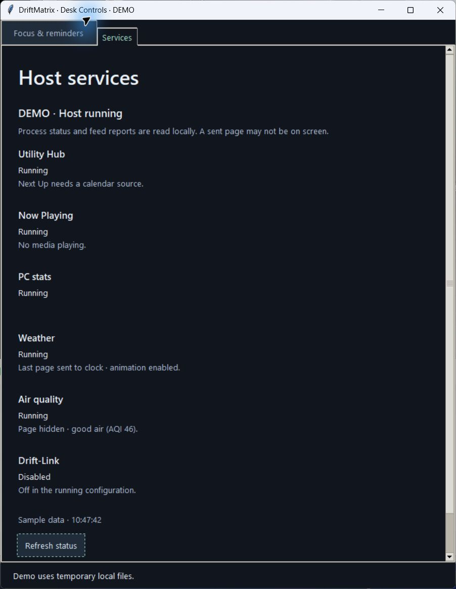

# Next Up setup status

Next Up deliberately stays idle when it is enabled without any calendar source.
The Hub logs a warning, but Desk Controls previously showed only Running for the
Hub. The Services tab now adds **Next Up needs a calendar source.** beneath that
process state.

The hint uses the exact validated canonical configuration selected by Controls.
It appears only when the Hub is enabled, Next Up is enabled, the source list is
empty, and the host is healthy, configuration-matching and confirmed running.
Disabled calendars, configured sources, stopped/stale hosts and mismatched
configuration do not receive the hint. Legacy mode does not guess a setup state.

The check describes source-list presence. It does not fetch a feed, verify account
access, validate calendar contents or promise that an existing source is reachable.
Calendar URLs and local source paths are never included in the displayed message.
No calendar is selected or enabled, no configuration is rewritten and no service
is restarted by this feature. Supplying a source remains a user setup choice.

The isolated native Services demo deliberately includes the missing-source case.
It uses temporary local files and synthetic activity, not a live calendar. Native
review and test results are recorded in the pull request; screen-reader and
narrow-window acceptance are separate checks.

Tests exercise the actual Controls model with validated selected configurations,
confirm the hint's process/freshness/configuration guards, preserve configuration
bytes and state directories, exclude private source values and verify the native
Services label. Current source-review coverage in `APP_OVERHAUL.md` is also
reconciled so old candidate notes cannot be mistaken for a live-host inventory.

Validation: **3,698 tests passed in 133.84 seconds**, including nine new cases.
The native Windows demo was inspected with the complete Services list and Refresh
control visible. This is synthetic preview evidence, not live calendar/provider
or physical-panel acceptance. No host adoption is included in this review.

The isolated installed wheel also passed the selected-config model and native
Services-label checks outside the checkout. Both changed runtime modules matched
the reviewed source; networking was blocked and configuration/state stayed intact.
