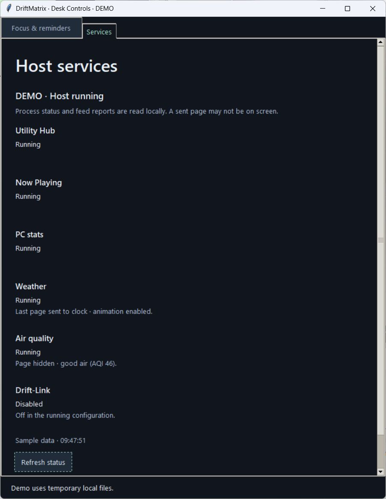

# Feed activity in Desk Controls

A feed can have a healthy process while its clock page is intentionally hidden or
while an upstream request is retrying. The Services tab previously showed only
Running, leaving those cases unexplained.

Weather and Air quality now report activity through their existing supervised
worker connection. The Services tab keeps process state separate and adds a short
explanation beneath it. `driftmatrix status` exposes the same optional activity
record for those services.

This is the actual Windows controls window with explicitly synthetic demo data.
It is not a screenshot of a live host or clock. The demo uses temporary local
files and does not start, stop, restart or contact the clock.

| Worker evidence | Explanation |
| --- | --- |
| Initial feed request | Checking the feed. |
| Successful page push | Last page sent to clock · animation enabled. |
| Successful static page push | Last page sent to clock · static icon. |
| Successful good-air removal | Page hidden · good air (AQI 46). |
| Failed provider request | Feed data unavailable · retrying in 30 s. |
| Failed clock push/removal | Clock delivery failed · retrying in 15 s. |
| Missing report from an older host | Feed activity has not been reported by this host. |
| Expired report or backward clock jump over five seconds | Feed activity is out of date; waiting for a new report. |

A successful push means the clock accepted the page; it does not mean the page
is currently on screen. An upstream failure can leave the previous page visible
until its existing expiry. The UI does not reinterpret that failure as a blank
clock. Current AQI relevance, forecast, hysteresis and quiet-hours rules remain
owned by the AQI sender. No new page or always-visible AQI policy is introduced.

## Reporting and freshness

Workers send a bounded state code, expected next-check delay and only the fields
required by that state: the AQI value when hidden or animation mode after a push.
They do not send provider URLs, raw exception text, configuration values or free
text into supervisor status. Only the known feed services can publish these
reports, and only AQI can report good-air hiding.

The supervisor stamps each valid report on receipt from that child's existing
IPC connection. It clears activity before every start or restart, preventing a
previous worker's success from being carried into its replacement. Malformed
reports are ignored. Old status files without activity stay readable.

A report remains current for its expected next-check interval plus 30 seconds,
with a minimum 30-second allowance for startup. This allows the normal 15-minute
AQI refresh without confusing it with the supervisor's short heartbeat. A live
supervisor heartbeat never renews the feed report timestamp. The controls suppress
feed explanations when the worker is stopped, the host is stale or its running
configuration differs from the selected one. Retry text counts down from the
worker's existing backoff; it does not schedule retries or alter restart policy.

Standalone and dry-run behavior is preserved. Diagnostics use no extra network
requests and perform no panel writes. Process RUNNING, delivery result and physical
appearance remain distinct evidence.

## Verification and adoption

Regression checks drive real sender loops through successful pushes, provider
failures, failed pushes/removals, repeated good-air hiding and dry-run paths.
They also cover stale/future timestamps, malformed and oversized numeric fields,
context cleanup, worker ownership/reset, backward-compatible status and native
Services labels.

The existing four real-fleet scenarios now inspect activity through the actual
worker IPC and CLI status. One scenario exercises AQI 46 and verifies its removal,
absence from pushed payloads and hidden-good-air report. The others verify accepted
static pushes. Native providers and upstream feed HTTP use explicit fixtures;
all panel traffic stays on the owned loopback server. Installed-package checks
repeat these scenarios outside the checkout.

Native Windows review confirmed the Services text, scrolling and bottom explanatory
note in the isolated demo. The preview window was closed afterward. Screen-reader
acceptance and narrow-window layouts have not been verified for this revision.

The full suite passed **3,659 tests in 133.82 seconds**, including **48 new
regression cases**, with no failures, errors or skips. An isolated built wheel passed all four actual-worker scenarios outside the
checkout in **47.47 seconds**, including good-air hiding and real IPC/CLI reports.
All six new/shared control and supervisor modules were verified against source.
CI results are recorded in the pull request.
Host adoption is separate: use a matching host and controls release, including any
existing shortcut that points at an older release. Preserve the config, task,
shortcut and clock snapshot/rollback evidence before a guarded cutover.
