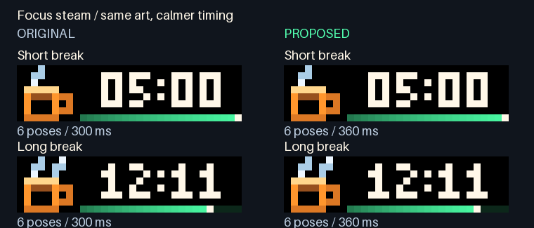
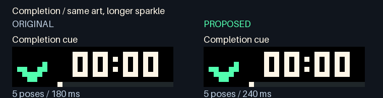
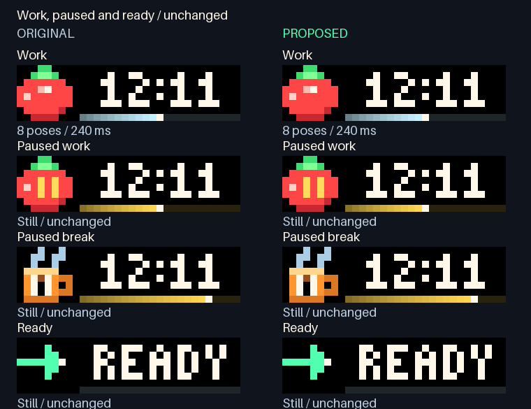

# Focus motion timing

Focus break steam used 300 ms GIF frames, and the completion sparkle used 180 ms
frames. Neither matches the repository's 120 ms timing rule: GIF centiseconds and
the 24 ms renderer tick first coincide at 120 ms. The usual 240 ms work orbit was
already aligned. This is a software timing-policy finding, not a measurement of
judder on physical LEDs.

The candidate preserves the entire RGB artwork and pose order. It gives steam a
slightly slower cycle and leaves more time to see the one-shot completion sparkle.

| Animation | Original | Proposed | Result |
| --- | --- | --- | --- |
| Short/long break steam | Six × 300 ms; 1.80 s loop | Six × 360 ms; 2.16 s loop | Calmer movement on the timing grid |
| Completion sparkle | Five × 180 ms; 0.90 s, once | Five × 240 ms; 1.20 s, once | Longer cue, ending on the same quiet check |
| Work orbit | Eight × 240 ms; 1.92 s loop | Same | Exact payload preserved |
| Paused, Ready and static fallback | Still | Same | Exact payload preserved |

Original is on the left; proposed is on the right. Both columns are decoded from
real prepared AWTRIX NG 1.2.2 payloads, with the same synthetic timer inputs.





The completion preview plays once. Reopen it to replay. The steam comparison loops
at 10.8 seconds, the common cycle boundary. The large comparison GIFs use a **60 ms
review-only clock** to represent both original and proposed delays exactly. They
are desktop review artifacts and must never be uploaded to a panel. The actual
proposed 8×8 icon GIFs use only 240 ms or 360 ms frame delays.



## Preservation and validation

`docs/focus-timing/before.json` freezes 16 synthetic actual-wire cases before the
edit, covering every visible state in animated/static mode and both paused-break
lengths. It records the original source identity, including LF/CRLF hashes.
Regression checks decode every original and candidate pose and require exact RGB
and order equality. All timer-lane bytes, colours, cycle pips, rails, background,
placement, page duration, lifetime and expiry metadata are equal. All unaffected
payloads are equal in full. Domain timers, session state and command handling are
outside this change.

The encoded-GIF validator now independently rejects animated frames with missing,
zero or non-grid delays, even if a caller supplies matching expectations. Static
single-frame GIFs with no duration remain valid. The original bad encodings are
retained as negative fixtures so another constant change cannot silently mask the
same issue.

Maximum prepared wire size in the 16-case corpus is **1,583 bytes**, below 2,048;
maximum icon size is **477 bytes**, below 850. Frame count and looping policy are
preserved. The actual worker/transport and physical appearance are separate from
this offline preview. There is no host adoption or panel write in this review.
Visual approval and fresh guarded-deployment checks are required before adoption.

Regenerate from the repository root:

```powershell
& 'C:/Users/devyn/anaconda3/python.exe' -X utf8 focus_timing_review.py
```


The approved timing is isolated on the Services baseline (PR #26). Pending media
and calendar-status changes are excluded. The Focus runtime source and comparison
artifacts are identical to the approved preview; only the surrounding baseline
and its validation results change.

Validation on this isolated baseline: **3,691 tests passed in 144.61 seconds**,
including 32 new Focus cases. This is the approved Services baseline plus Focus;
it excludes the pending media and calendar updates. The earlier stacked candidate
passed 3,730 tests, but is not the adoption candidate. Actual-worker installed
verification and exact-head cross-platform CI are recorded in the pull request.
