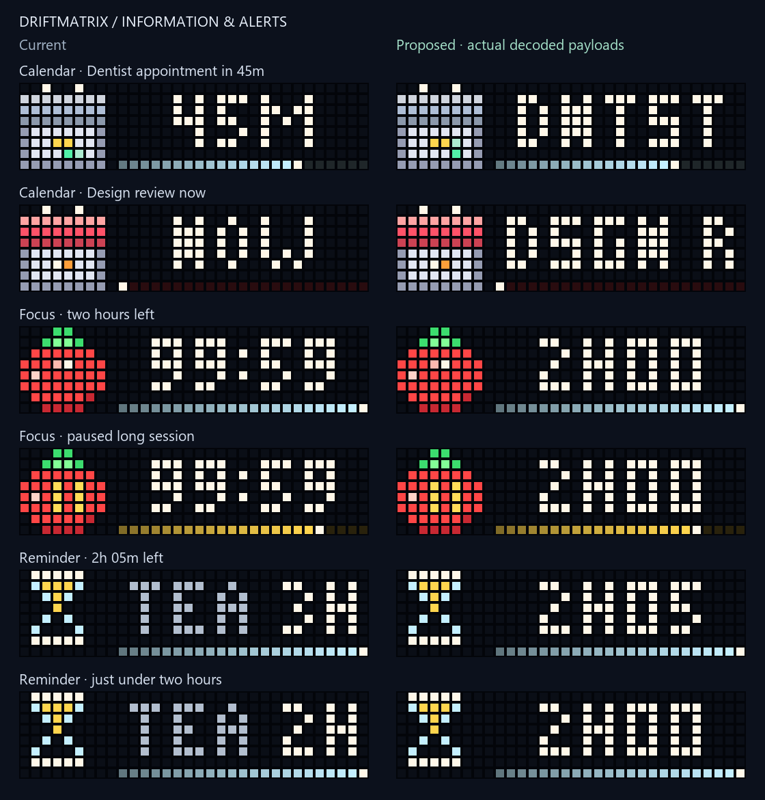

# Calendar identity and long timer readability

The audit found two confirmed information failures. Next Up usually discarded the
event title because it could not fit beside the ETA. Focus capped any timer above
99:59 at 99:59, while a 125-minute reminder rounded up to 3H. These were visible
behavior problems, even though the underlying timer state was correct.

## Candidate behavior

Next Up now holds the ETA for 2.4 seconds, then its compact event title for 2.4
seconds. The calendar's highlight continues around its original ten-position
path; NOW keeps the calendar icon still. Text stays stationary while each card
is shown. The same countdown rail and black x8 gutter remain through both cards.
Configured aliases reach the title card, and width checks use the actual common
font, including its wider M and W. This adds no app slots or host requests.

The 32×8 GIF uses one exact shared palette and delta rectangles. In the four
review cases the complete current-firmware wire bodies are 529–945 bytes, with
images of 258–570 bytes. No colors are quantized. Static safety mode retains the
single still 8×8 calendar plus bitmap ETA lane; it does not alternate titles.
A shortened requested page duration is extended to one 4.8-second cycle, and an
animated lifetime shorter than a complete cycle is rejected.

Focus uses MM:SS below 100 minutes, then explicit hours/minutes: `2H05` for two
hours and five minutes. Reminders retain minutes through 99M, then show the same
hour/minute form. Minute-resolution readings round up; positive time never reads
zero. Extremely extended Focus sessions use the explicit lower bound `99H+`
rather than an apparently exact capped value. State, queues and deadlines are
unchanged.



## Review corpus and reproduction

The self-contained `figures/information-overhaul/index.html` compares 30 sample
states across Focus, reminders, calendar, PC alerts including NET, aircraft,
earthquakes, gaming and Miku's health/activity states. Eight screens change;
22 are explicitly unchanged references. Every preview decodes the real GIF and
bitmap payload, with firmware 1.2.2 image prefixes and real frame timings.

Safety view uses real sender-provided safety payloads. Aircraft, earthquakes and
gaming have no separate safety payload; the gallery explicitly freezes their
first frame for inspection. This does not add a fallback to those senders.
Low-light mode is a channel-threshold model, not a physical measurement.

The baseline was captured before edits and expanded using the four unmodified
source modules from `79b55e6b95f0fed8da9ace34eec8a48cc755f9b4`. Every original
baseline frame and timing reproduced exactly before the extra NET/Miku cases
were added. `manifest.json` records baseline/source hashes and the changed scene IDs.

Regenerate from the checkout (previews are not part of the installed CLI):

```powershell
& 'C:/Users/devyn/anaconda3/python.exe' -X utf8 information_preview.py --before figures/information-overhaul/before.json --baseline-revision 79b55e6b95f0fed8da9ace34eec8a48cc755f9b4 --out figures/information-overhaul
```

Validation: **2,876 tests passed in 57.56 seconds**, including 39 new cases.
Checks cover truthful time bounds across a supported day, invalid durations,
long timer/name bitmap contents, exact GIF color round trips, held title/ETA
lanes, frame timing, difficult titles, lifetime/size limits and the still safety
variant. Preview sizes/hashes match prepared HTTP bodies without sending them,
including the serializer's spacing and inline image prefixes. Maximum wire size
among all 30 samples is **1,640 bytes** against the 2,048-byte limit. The installed
wheel was exercised outside the checkout.
Browser checks covered filtering, pause/restart, 20 exact 120ms steps to the
title card, safety selection and low-light inspection. Narrow-screen and
screen-reader acceptance have not been verified in this follow-up.

## Remaining findings and adoption gates

The NET sample exposed a separate unit bug: its MB/s input reaches a generic
percentage renderer. That remains a confirmed follow-up, with a real reference
in this corpus. Earthquake distance is represented only by an unlabeled proximity
rail, and Game Mode receives session duration but does not display it. Those
information choices need further work; unchanged reference status is not a claim
that those apps are finished.

This candidate has not been sent to the physical clock. Lower encoded size does
not prove lower decoder memory use: the new GIF has a full 32×8 canvas instead
of an 8×8 icon plus static bitmap. Fresh snapshot, guarded transport, source and
configuration rollback, memory checks, visual approval and physical acceptance
remain required for adoption. Existing heap guards and their ratios are unchanged.
The canary test now verifies the real generated payload size rather than assuming
that it must exceed 1,000 bytes after encoding improved.
