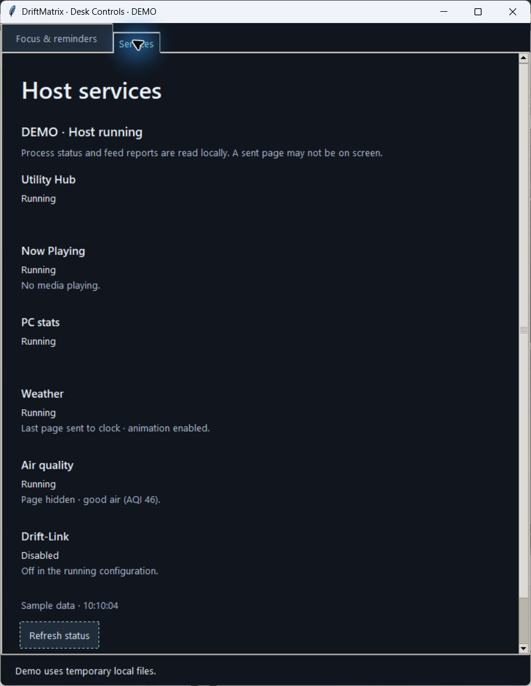

# Now Playing activity and expected client disconnects

Now Playing can have a healthy process without any media to display. Its Services
row previously explained neither that idle state nor a Windows media read failure.
This candidate adds short local activity messages through the worker-reporting
channel introduced in `FEED_ACTIVITY.md`.

The actual Windows preview uses synthetic demo data and temporary local files.
It does not inspect live media or contact the clock. The final wording and native
layout were reviewed, and the preview was closed afterward.

| Evidence from the media worker | Message |
| --- | --- |
| Startup before the bridge is ready | Preparing the media bridge. |
| LAN binding or resident-source verification retry | Media bridge setup unavailable · retrying in 2 s. |
| Playing snapshot published to its local state store | Playback detected. |
| Successful poll with no playing session and no retained active state | No media playing. |
| Inactive poll during the existing brief grace period | Playback inactive · waiting briefly. |
| Windows manager/metadata read failed | Windows media unavailable · retrying in 2 s. |

Retry delays in these examples are illustrative; the text counts down from the
worker's existing retry schedule. A playing report means the PC has published
current state locally. It does not claim the clock fetched it or that the page
is on screen. An idle report is based on a successful native media read, never
inferred from an HTTP refusal or a failed Windows read.

No title, artist, player identity, URL or raw exception text enters activity
status. Media reports contain only a fixed state and next-check delay; the
supervisor adds the receipt timestamp. Service-specific allowed states prevent
media from claiming feed delivery or good-air hiding, and prevent other workers
from claiming media activity. Existing process identity, report expiry, restart
reset and stale/config-mismatch controls remain.

## Disconnect handling

A client that leaves during an HTTP response can raise `BrokenPipeError`,
`ConnectionResetError` or `ConnectionAbortedError`. The threaded server previously
printed a server traceback for these expected disconnects even though the worker
continued serving subsequent requests.

The bridge now records only the exception class at DEBUG for those three types.
It keeps the standard server error-reporting path for other exceptions. A dropped
request still fails; it is not changed into a successful response. The server's
normal request cleanup closes that connection, and a later request can retrieve
the current state.

The configured panel-IP allowlist, endpoint/method rules, JSON body, response
headers, cache policy and stale-state privacy behavior are unchanged. This does
not permit localhost or other clients into a production bridge that already
refuses them. It adds no clock requests or mutation calls.

## Local status-file access

The local supervisor reader now retries `PermissionError` up to six reads with
10/20/30/40/50 ms waits, a maximum 150 ms scheduled delay. A brief access denial
can therefore recover while another process updates a record. Persistent denial
still returns the same sanitized error. Missing files, malformed JSON, non-finite
values, oversized records and other read failures are not retried or replaced
with cached success. Process identity and authenticated stop checks still run on
the record actually read.

Deterministic contention tests cover immediate success, recovery, exhaustion and
strict malformed/missing rejection. The full fleet scenarios exercise the real
CLI reader during active supervisor heartbeat publication. A later readable
heartbeat alone does not establish the cause of any earlier failed read; the
bounded change specifically covers permission-denial contention.

## Lifecycle and verification

The normal 2.5-second pause grace, 5-second media-error grace, manager retry and
poll intervals remain unchanged. Reporting happens after the existing local-state
transition. A Windows read failure reports unavailable even during the grace
period in which the previous track is briefly retained. Recovery reports playing
again when the native provider supplies a new snapshot. Shutdown still clears the
store, closes the HTTP server and joins its thread.

Tests run the actual async producer with a controlled native boundary and clock,
covering idle startup, pause/grace/clear/resume, read failures, retained state,
manager backoff, recovery, setup retries, privacy and stale activity. Real loopback
HTTP tests interrupt response-body writes with each expected disconnect type and
then require the next complete response to match the unchanged state/headers.
Unexpected failures must retain normal error reporting.

The four actual-worker fleet scenarios verify the media report across real IPC
and `driftmatrix status`, alongside feed activity, first-image format, Focus
receipts, ownership, gated requests and cooperative shutdown. Native OS sources
and upstream feed HTTP use explicit fixtures; no physical clock is contacted.
The installed package repeats these scenarios outside the checkout.

The full suite passed **3,689 tests in 133.00 seconds**, including **30 new
regression cases**, with no failures, errors or skips. An isolated built wheel
passed all four actual-worker scenarios in **47.45 seconds** outside the checkout.
Eight installed control/supervisor/media modules were checked against source.
CI results are recorded in the pull request. This source
candidate does not switch the live host, configuration, task, shortcut, resident
scripts, brightness, rotation or playback. Guarded adoption needs a matching host
and controls release; physical lit-playback acceptance remains separate. Native
screen-reader and narrow-window acceptance are not established by the preview.
