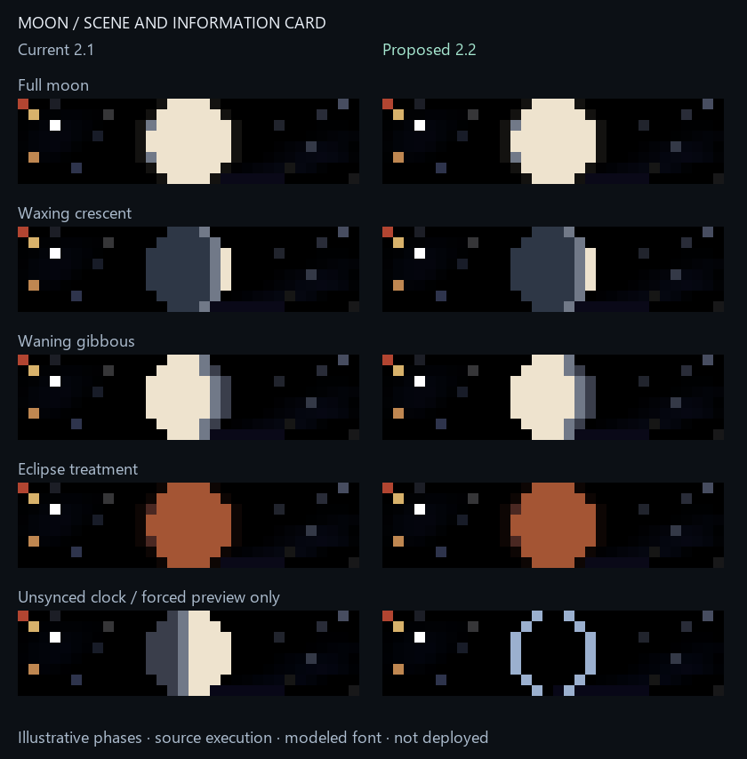

# Moon 2.2 candidate

`weather/moon-panel-v2.2.ax` is a separate candidate. The installed 2.1 source
`weather/moon-panel.ax` is unchanged and remains the versioned rollback reference.

## Improvements

- Show a complete illumination unit, including **100%**. The old full-moon card
  shortened this to `100` to fit its fixed positions.
- Measure both fields with the firmware's `text_ink_width`, center them as a group
  with a two-column gap, and never overlap them. If a larger native font makes the
  pair wider than 32 columns, show the phase and percentage in turn, each centered.
- Use a brighter cool percentage color. Ease star and shooting-star brightness
  down as the information card comes into view, so bright background points do not
  compete with the letters.
- Limit camera movement to one physical column per completed draw. The desired
  smoothstep timing remains, but a slow/late frame cannot skip several columns.
  At sufficiently low frame rates the fixed 11-second turn can end before the
  return movement completes; the next visit safely resets the camera.
- Show `SYNC / --%` and a neutral outline when manually activated without a valid
  clock. Both versions already suppress normal rotation before sync; this is an
  honest manual-preview state, not a change to the normal availability rule.

The phase calculations, true terminator geometry, horizon/eclipsed colors, nebula,
all-day availability with a valid clock and 11-second visit duration are preserved.



## Preview evidence

`moon_review.py` executes the actual old and new Berry sources through the existing
float32 subset compiler and framebuffer natives, including intermediate draws and
one-second loops. Phase values in the comparison are deliberately selected design
examples, not current astronomical readings or eclipse predictions.

The font combines glyphs captured from the firmware where available with the
project's 3x5 font for other characters. It is explicitly a model; source execution
does not make unobserved glyphs or this preview a live framebuffer capture. Actual
device field positions use the firmware's own width measurement.

The new 33 checks cover phase/percentage bounds for waxing and waning states,
larger-font alternation, camera movement at five frame intervals, interrupted
visits, pre-sync and clock-loss states, transition to a valid clock, quiet info
backgrounds, minified execution, and unchanged astronomical/disc results at fixed
epochs. The full local suite passed **2,812 tests in 55.62 seconds**.

Regenerate from the repository root:

```powershell
& 'C:/Users/devyn/anaconda3/python.exe' -X utf8 moon_review.py --output figures/moon-overhaul
```

The new minified source is **11,855 bytes**, compared with **10,918 bytes** for
the installed source. The reference SHA-256 remains
`90cd90e057a969d3011d17c3d8b6e5b35d838c5be28f9967237cab9d1f9f0669`.
Hashes and preview limitations are recorded in `moon-review.json`.

## Remaining adoption checks

No live script, host service, configuration, scheduled task, brightness or power
was changed. The candidate still requires user visual review, a fresh snapshot,
guarded swap with the exact 2.1 rollback source/version, post-boot compile and
memory/FPS checks and physical appearance verification. ESP32 heap and FPS are
unmeasured; the larger source is not evidence that it fits the constrained device.

The broader app/functionality/QoL overhaul remains active.
