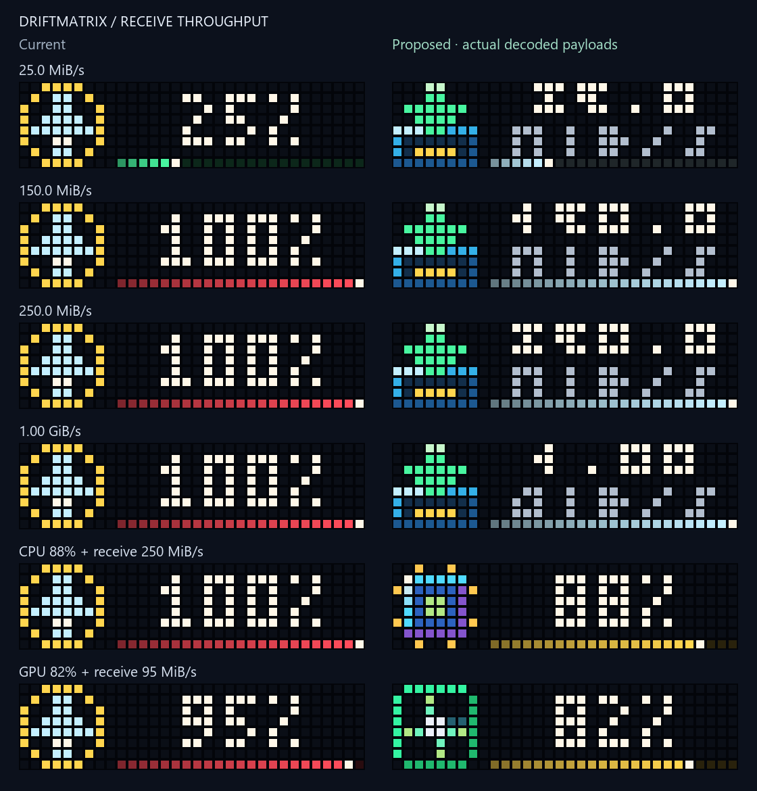

# Receive-throughput readout

The network alert used a percentage renderer for a receive-rate input. Readings
above 100 were clamped to the same 100% payload, and the change detector could not
see a 150→250 MiB/s change. Raw throughput also competed numerically with CPU/GPU
percentages, allowing traffic to displace a hardware alert.

## Candidate behavior

The network page now shows the rate and its binary unit together, using two
3-pixel-high text rows and a one-row throughput rail. `150.0 MiB/s` and
`250.0 MiB/s` are distinct readings; at 1024 MiB/s the label changes to GiB/s.
MiB/s uses one decimal, GiB/s two. Invalid direct API samples show `--`; the live
sampler's existing gate still retains the previous good reading on an unavailable
sample. A zero rate has a bare rail, and an extreme out-of-range API value uses
the explicit lower bound `999+ GiB/s`. The existing live gate ceiling remains
10000 MiB/s.

A shaded receive tray and descending packet highlight replace the generic dial.
Its six distinct 240ms poses loop continuously. Static fallback uses the same
value/unit bitmap and a still receive icon. The app remains one 8×8 GIF icon plus
a 23×8 static bitmap; no full-width GIF, extra app slot or extra sender is added.

The rail is an explicit configurable visual reference, with default full scale
100 MiB/s. It does not claim measured link utilization or negotiated NIC speed.
High throughput uses the information palette rather than a false critical-load
color. The sampler remains aggregate bytes received from `psutil`, using 1024²
bytes per MiB; uploads and individual adapter selection are not added here.

Hardware alerts take priority when active. Among hardware metrics, the existing
GPU-critical and CPU+RAM selection rules remain. When no hardware alert is active,
an elevated receive rate can still show the network page.



## Configuration and refresh

Optional canonical settings:

```json
{
  "services": {
    "pc_stats": {
      "enabled": true,
      "options": {
        "network_full_scale_mib_s": 100,
        "network_refresh_delta_mib_s": 3
      }
    }
  }
}
```

This is a fragment for review, not a complete configuration or an instruction to
overwrite a running file. Both settings must be finite positive numbers at most
10000. Percentage pages retain `refresh_delta_points`. Throughput refresh compares
the visible rate in MiB/s; unit and rail changes also count as visible changes.
The existing confirmation streak, minimum push interval, keepalive, quiet hours,
backoff, ownership and static-recovery behavior are preserved. Settings reach
both the renderer and the change detector through the supervised worker.
The standalone sender retains defaults.

## Review and validation

The self-contained `figures/network-overhaul/index.html` compares 14 illustrative
states: low/fractional/large rates, the MiB/GiB transition, zero, diagnostic missing
data and mixed hardware alerts. Baseline payloads were captured before edits at
`e49dc6690f351234c33301e663f1efb959354cd2`. `manifest.json` records the baseline and
normalized source hashes. Sizes match prepared HTTP bodies including image prefixes
and serializer spacing. Maximum sampled wire body is **1,567 bytes** against the
2,048-byte limit; standalone network pages are **1,335 bytes animated / 1,071 static**.

Regenerate from the checkout:

```powershell
& 'C:/Users/devyn/anaconda3/python.exe' -X utf8 network_preview.py --before figures/network-overhaul/before.json --baseline-revision e49dc6690f351234c33301e663f1efb959354cd2 --out figures/network-overhaul
```

**2,918 tests passed in 61.53 seconds**, including 42 new cases. Checks cover units,
actual bitmap contents, values over 100, page/payload identity, refresh thresholds,
canonical options, selected-endpoint pushes, exact GIF colors/cadence/opacity,
low-light silhouette and unchanged fallback lanes. A whole-sender simulation
verified the 150→250 MiB/s update without lifetime gaps. The built wheel's helper,
schema and scaled renderer were exercised outside the checkout.

The rendered comparison was inspected. Browser interaction was not verified:
the in-app browser returned an older gallery, and browser security policy rejected
opening the saved local HTML file. The preview is generated from the existing
gallery template, but that does not substitute for interaction or screen-reader
acceptance of this candidate.

No live configuration, host release, scheduled task or physical clock was changed.
Visual approval, fresh snapshot/rollback evidence and guarded physical appearance
and stability checks remain required for adoption. Smaller payloads and simulated
low-light checks are not physical-device acceptance.
