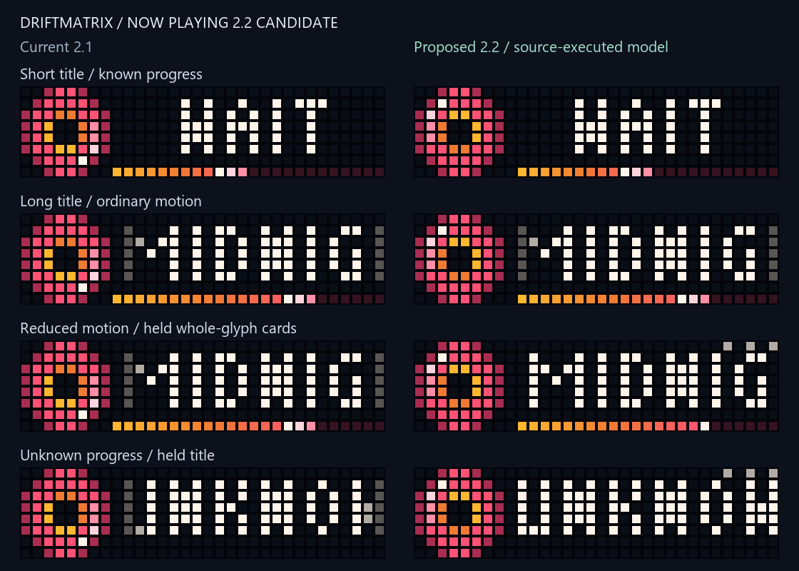
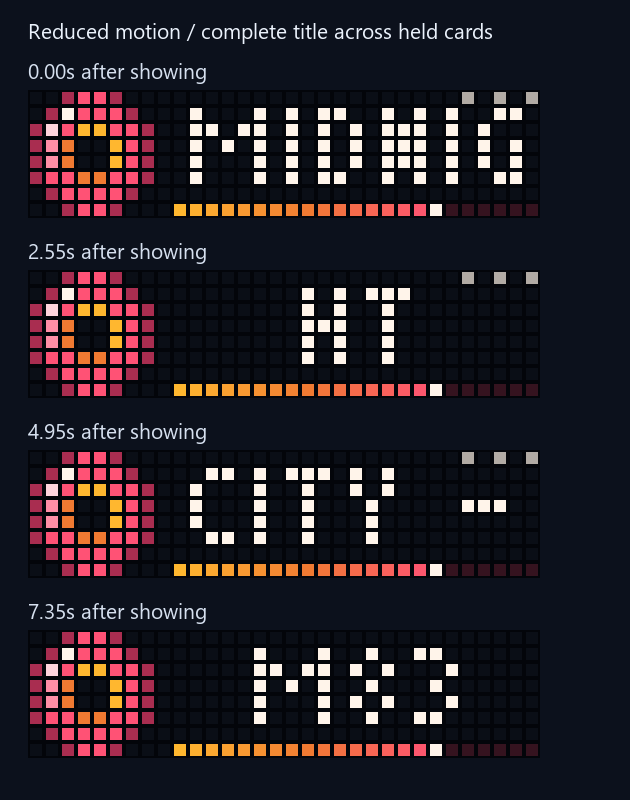

# Now Playing 2.2 candidate

`now_playing-v2.2.ax` is a separate candidate. The existing `now_playing.ax` 2.1
reference, default template selection and default bridge response are unchanged.
The new source is included in the built wheel for explicit, guarded adoption.



## Layout and motion

The progress rail moves to x9–31, leaving column 8 black all the way down. The
bridge retains its existing `-1`/`0..24` progress contract. The candidate rounds
known buckets to 23 visible cells; the error is at most half a cell relative to
that wire value. Unknown progress has no rail, zero has an empty track and full
progress fills all 23 cells. The leader animation never adds false progress.

The shaded coral record retains its original twelve poses and palette. It now
advances at most one pose after a completed visible draw, with a minimum 150ms
interval. Hidden time and delayed frames cannot skip ahead through several poses.
Slow rendering can lengthen its revolution. A return visit resumes the held pose.

Ordinary title behavior is retained: proportional 3×5 glyphs, centering for short
titles, fixed edge fading for overflow, a one-second opening hold and one physical
column per three completed draws. A fitting title stays seven seconds; a long
title normally finishes its first complete scroll before rotation advances. The
120-second emergency ceiling and five-minute reminder policy remain unchanged.

Stopped/stale media still leave rotation. Outgoing frames now show `IDLE` instead
of retaining the old track title. Repeated inactive polls cannot repeatedly
request the next page. Overlong identity/title documents are rejected before
building an oversized glyph cache; the producer already bounds these fields.

## Optional reduced motion

The canonical media worker accepts `reduced_motion: true`. Its read-only HTTP
state adds optional `m: true`; ordinary responses retain the exact existing keys.
The candidate uses a still record, a still progress leader and held title cards.
Each card remains for at least 2.4 seconds. Cards prefer word boundaries and split
oversized words only between whole glyphs. Three quiet dots above the title show
that more cards follow; the last card has no continuation dots. Every non-space
character remains visible in order, at full title brightness.



Cards advance at most once after a completed draw, so a late frame cannot consume
several unread cards. Hidden draws consume no cards; the next visit begins with
the first card. The ordinary scroll counter is inactive in this mode. Progress
updates preserve the current card, while new titles, track identities and motion
mode changes reset the reading sequence. Very slow rendering can still reach the
unchanged 120-second emergency ceiling before a pathological title finishes.

Example **options fragment for review**, after the matching candidate has been
reviewed and installed through the guarded swap path:

```json
{
  "services": {
    "media": {
      "enabled": true,
      "options": {
        "script_path": "C:/path/to/reviewed-release/now_playing-v2.2.ax",
        "allow_script_install": false,
        "reduced_motion": true
      }
    }
  }
}
```

Supply the actual reviewed release path. This fragment does not replace a running
configuration. Both configuration and the state store require a strict boolean.
Requesting reduced motion with a template lacking its explicit capability marker
fails before DNS resolution, server creation or panel mutation. Existing 2.1
templates remain the default. When embedding an already-created state store, its
constructor owns the mode; a conflicting explicit enable flag is rejected.

## Verification and limits

`now_playing_review.py` runs the reference and candidate through `berry_lite`,
including their state handling, glyph conversion, draw methods, timing and
rotation calls. Imports, JSON decoding/exception handling and the HTTP callback
are explicit native adapters. It does not run the ESP32 firmware, actual Berry
JSON implementation or network stack. The reference output is checked against
the existing preview's font, record and rail pixels. Both raw and minified
candidate sources produce matching framebuffers and rotation results.

The subset compiler now supports inclusive integer range literals. The modeled
default increment is one, following the [Berry language documentation](https://berry.readthedocs.io/en/latest/source/en/Chapter-2.html#range)
and [range reference](https://berry.readthedocs.io/en/latest/_static/berry_short_manual.pdf).
Tests cover inclusive/equal/empty/negative bounds and reject noninteger bounds.
The lexer distinguishes adjacent range dots from real-number decimals.

The four-state comparison executes intermediate draws at 25ms intervals and
exports at 150ms over 10.8 seconds, including complete title-card visits. It marks
rotation completion explicitly; it does not invent the next app's framebuffer.
`frames.json` records RGB frames, while `manifest.json` records the baseline,
normalized source/model hashes, timings and template/rendered sizes.

Regenerate from the checkout:

```powershell
& 'C:/Users/devyn/anaconda3/python.exe' -X utf8 now_playing_review.py --output figures/now-playing-overhaul
```

Tests cover every wire bucket, fixed fill during highlights, unchanged ordinary
scrolling, low/nominal frame rates, hidden intervals, whole-glyph card coverage
over ordinary and generated metadata, complete visit timing, mode/title changes,
manual navigation, stale/idle behavior, raw/minified execution, schema validation,
the supervised adapter and a real loopback HTTP state server. That server is
isolated from the panel; its shutdown is verified. Installed-package checks run
outside the checkout and verify both script resources, schema, optional flag and
rejection of an incompatible template. **3,029 local tests passed in 63.65 seconds**,
including 58 new cases, with no failures, errors or skips. CI evidence is in the PR.

The rendered comparison and complete held-card sequence were inspected. Browser
interaction, screen-reader acceptance and physical LEDs remain unverified. The
earlier saved-file browser security rejection was not worked around.

The minified templates are **7,349 bytes (2.1)** and **9,553 bytes (2.2)**. With
the manifest's synthetic state URL they are **7,369 / 9,573 bytes**. Actual source
size depends on the host URL. These are source sizes, not VM heap measurements;
the candidate's additional compiled code and optional card-offset cache have
unmeasured device cost. Cards reuse the existing column pixels, and `draw()` adds
no glyph parsing, JSON, HTTP calls, lists or color interpolation.

No live host, configuration, scheduled task, script, brightness or clock state was
changed. The panel already has a constrained shared VM budget. Adoption requires
visual approval, a fresh snapshot, an exact versioned 2.1 rollback source with the
correct state URL, minification, guarded swap, boot compile/memory/FPS checks and
physical appearance/stability verification. Candidate size is not proof of fit.
