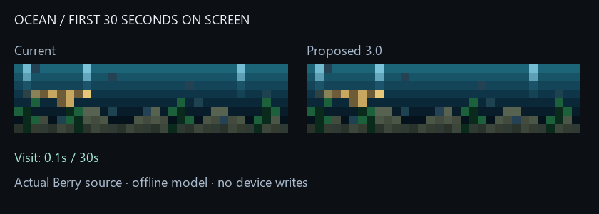

# Ocean 3.0 candidate

This is an offline candidate, not the script currently installed on the clock.
`ocean.ax` remains unchanged as the normalized, byte-exact rollback reference.

## What improves

- The whole scene uses rotation-visible time. Swimming positions already advanced
  only in `draw()` in the old source, but encounter deadlines, water phases and
  the short timed seafloor visitor used wall time. Those now pause together when
  `on_hide()` runs and resume through `on_show()` without catching up a hidden gap.
- The first manta-shaped visitor starts at 12 seconds of scene time, entering the
  visible matrix during the first normal 30-second turn. Its body and wing/tail
  colors are brighter blue, distinguishable against the water and above the
  project's low-light channel threshold. Later encounters retain their existing
  spacing and the fish school, plants, bubbles and background composition remain.
- The two light caches use 416 explicit bytes instead of two lists containing
  160 entries. RGB values remain exact; no color quantization is used for packing.
  Actual VM heap savings and ESP32 frame rate are **not measured**.
- Version/name metadata now identify the candidate in the panel inventory.



The GIF samples the complete first 30-second turn every 120 ms while executing
all intermediate 40 ms source draws. The still is taken at about 20 seconds so
the proposed encounter can be inspected without waiting for the animation.
This is a fresh-load scenario with illustrative clocks, not a live framebuffer.

## How it is verified

`ocean_preview.py` executes both actual `.ax` files through the existing `berry_lite`
compiler, with float32 arithmetic and the same 32×8 framebuffer natives used by
the Moon source checks. It does not substitute a hand-transcribed Ocean renderer.
The shared-module stub models only the schedule keys used by Ocean.

The new tests cover hidden intervals, resumed positions, the first visible visitor,
the timed seafloor encounter that previously expired while hidden, all six visiting
creature paths, daytime/shared scheduling, minified execution and arbitrary byte
buffer initialization. Reference pixel comparisons align only the intentional
first-visit deadline and two manta colors to isolate cache/render changes.

Validation: **2,779 tests passed in 54.09 seconds**, including 22 new Ocean checks.
The lifecycle hooks follow the official [AWTRIX NG scripting contract](https://blueforcer.github.io/awtrix-ng/esp32/guides/scripting/).

Regenerate from the repository root:

```powershell
& 'C:/Users/devyn/anaconda3/python.exe' -X utf8 ocean_preview.py --output figures/ocean-overhaul
```

The normalized reference source SHA-256 is
`5000462ec6ea5f02a831331bd71e77c81e244c50a271afc33bca6de9adc50b7f`, matching
the earlier direct panel readback. New-source hashes, minified upload size, cache
representations and the sampled frame hashes are recorded in `ocean-review.json`.

## Physical adoption is still pending

This model cannot measure Berry compiler compatibility outside its supported
subset, VM allocations, physical brightness or the ESP32's draw timing. The
candidate is 10,904 bytes minified, so it remains subject to the script swap's
contiguous-memory preflight and recovery policy.

The installed legacy Ocean has no version header. The explicit unversioned mode
in `script_swap.py` now implements separate original/upload hash pins, fresh
source proof under the mutation gate, exact snapshots and resume/rollback checks.
See `LEGACY_SCRIPT_IDENTITY.md`. Fresh live identity, validated maintenance and
rollback, guarded replacement, post-boot memory/FPS and physical checks remain.
Do not relabel or overwrite `ocean.ax` merely to satisfy preflight.

No resident script, host configuration, scheduled task, panel power or brightness
was changed while preparing this candidate. The overall app overhaul remains active.
