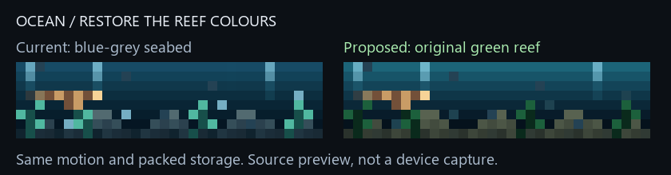

# Ocean 3.3: restore the original reef colour balance

Physical feedback on Ocean 3.2 was: “Its all just blue now.” The live source
matched the pinned 3.2 hash, and display inspection found no overlay or palette
filter. Twenty naturally rotating framebuffer samples contained 4,573 blue-dominant
pixels out of 5,120 (89.3%). This is API evidence, not a photograph of the LEDs.

The art revision had changed the olive/green seabed to blue-grey, the kelp to cyan,
and the bubbles to bright blue. The compact 3.2 source preserved those 3.1 colour
values; its data packing did not restore the older environment palette.

## Correction

The separate `ocean-v3.3.ax` source restores `ocean.ax`'s original eight water
colours and environment entries 6, 7, 8 and 15..21: kelp, bubbles and olive reef.
Gold fish, the revised manta and all other visitor colours stay unchanged. Motion,
encounter timing, hidden-time behavior and packed storage are unchanged. The original
source and previous versioned sources are preserved.



The normalized 32x8 comparison executes both actual sources through the float32
subset model. It covers 30 visible seconds with 40 ms draws, sampled every 120 ms.
All non-colour animation state matches. In this matched comparison, green-dominant
pixels rise from 8.8% to 25.8%; the water remains blue/teal. The colours restore the
original environment, rather than adding a new background effect or extra objects.
These counts describe RGB dominance and do not model LED gamma or human perception.

## Verification

**3,439 local tests passed in 138.81 seconds**, zero failures, errors or skips,
including 22 new palette/state cases.

Focused checks cover exact original environment values, preserved visitor colours,
unchanged buffer sizes and constructor retirement, all six visitors and seed/state
progress over seven visible minutes, hidden intervals, a persistently green reef,
and raw/minified parity. The correction adds no state or runtime methods.

The hash-pinned official upstream Berry runtime also compiles and executes both
sources through 400 draws. Both retain 20,492 bytes after creation and 21,640 bytes
after warm draws/collection in that runtime. This is not ESP32 admission evidence
or a bound on transient peaks; actual compiled cost and the unchanged 75% shared
VM ceiling still require guarded device checks.

```powershell
& 'C:/Users/devyn/anaconda3/python.exe' -X utf8 ocean_palette_review.py --output figures/ocean-palette
```

Minified 3.3 source: **9,483 bytes**, SHA-256
`c18e5aaf5277f0a1c2dc28bdafe691dd3f6ad7a2b1a76a5841e9adc185ee040e`.
The source-derived contiguous upload floor is **33,191 bytes**. No change to
firmware settings, brightness, overlay, Nightkeeper, host configuration or resident
scripts was made during diagnosis and proposal generation.

The user approved the restored reef preview on October 29, 2026. Ocean 3.2's
physical colour review failed; the correction still needs physical acceptance
after installation. Installation still requires fresh
snapshots, current exact source proof, explicit 3.2 rollback pins, the reviewed
mutation/maintenance guard, memory verification and new physical colour acceptance.
