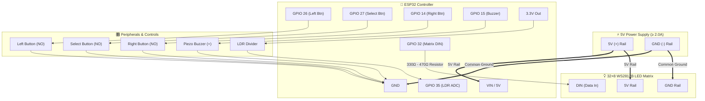

<div align="center">

# ⚡ DriftMatrix

### Intelligent 32×8 RGB LED Matrix Desk Companion & Telemetry Display

[](LICENSE)
[](https://www.python.org/)
[](https://espressif.com/)
[]()
[]()
[](#-the-drift-hardware-ecosystem)

*A responsive desktop companion driving an individually addressable 32×8 RGB matrix with float32 celestial tracking, smooth typography, Windows media integration, and PC telemetry.*

[Overview](#-overview) •
[Visual Showcase](#-visual-showcase) •
[Hardware & Wiring](#-hardware--wiring) •
[On-Device Apps](#-on-device-apps-berry-vm) •
[PC Companion Suite](#-pc-companion-suite-python) •
[Quickstart](#-quickstart--setup) •
[Ecosystem](#-the-drift-hardware-ecosystem)

</div>

---

## 🧭 Overview

**DriftMatrix** is the desk-side visual anchor of the **Drift** hardware ecosystem. Built atop an ESP32 microcontroller and the AWTRIX NG engine, DriftMatrix combines on-device Berry virtual machine micro-apps with a Python companion service running locally on your workstation.

```
       WORKSTATION (PC)                          DRIFTMATRIX (ESP32)
  +-------------------------+               +----------------------------+
  |  Windows Media Session  |               |  Berry VM (Embedded Heap)  |
  |  NVIDIA GPU Telemetry   |  HTTP / REST  |   - Moon Tracker (v2.1)    |
  |  Google/Outlook ICS     +-------------->|   - Vinyl Media Scroller   |
  |  Commute & Travel Radar |   Push API    |   - Ocean Wave Simulator   |
  |  Desk Controls GUI Tray |               |   - Nightkeeper Scheduler  |
  +-------------------------+               +--------------+-------------+
                                                           | GPIO 32 (WS2812B)
                                                           v
                                            +----------------------------+
                                            |   32x8 RGB LED MATRIX      |
                                            |   [0..7]   [8]   [9...31]  |
                                            |    Icon    Gap   Text Lane |
                                            +----------------------------+
```

### 📐 The Layout Contract
Every pixel on the 32×8 canvas follows a strict spatial hierarchy:

```
  x:  0 1 2 3 4 5 6 7   |  8  |   9 10 11 12 13 ... 28 29 30 31
 y0:  . . . . . . . .   |  .  |   .  .  .  .  . ...  .  .  .  .
 y1:  . . # # # . . .   |  .  |   .  .  .  .  . ...  .  .  .  .
 y2:  . # # # # # . .   |  .  |   .  N  O  W     P  L  A  Y  .
 y3:  # # # # # # # .   |  .  |   .  .  .  .  . ...  .  .  .  .
 y4:  # # # O # # # .   |  .  |   .  B  o  h  e ...  i  a  n  .  <- Centered Mass
 y5:  # # # # # # # .   |  .  |   .  .  .  .  . ...  .  .  .  .
 y6:  . # # # # # . .   |  .  |   =  =  =  =  = ...  =  =  -  -  <- Text Baseline
 y7:  . . . . . . . .   |  .  |   .  .  .  .  . ...  .  .  .  .  <- Clear Rail
     +---------------+     +     +-----------------------------+
        Icon Well        Gutter          Dynamic Text Lane
       (Columns 0-7)   (Column 8)        (Columns 9 to 31)
```

* **Icon Well (`x0–x7`):** Visual mass centered on row `y4`.
* **Gutter (`x8`):** Unlit column separating iconography from alphanumeric data.
* **Text Lane (`x9–x31`):** High-legibility proportional typography anchored on row `y6`.
* **Clear Rail (`y7`):** Reserved for ambient gauges, progression timelines, or kept dark.

---

## 🎨 Visual Showcase

| App | Icon Well | Text Lane Preview | Description |
| :--- | :---: | :--- | :--- |
| **Moon Tracker** | `🌔` | `WAXING  82%` | Float32 astronomical ephemeris with earthshine and real crater placement |
| **Now Playing** | `💽` | `Queen - Bohemian Rhapsody` | Smooth-scrolling artist & track with animated rotating vinyl disc |
| **PC Telemetry** | `⚡` | `GPU 58°C  CPU 32%` | Real-time PC hardware vitals via `nvidia-smi` and system counters |
| **Ocean Ambient**| `🌊` | `... drifting ...` | Relaxing procedural multi-harmonic sinusoidal wave animation |
| **Calendar Next**| `📅` | `11:30 AM  Team Standup` | Upcoming meeting agenda alerts parsed directly from calendar feeds |
| **Weather Suite**| `☀️` | `78°F  CLEAR SKY` | Micro-weather station with solar dawn/dusk timelines and air quality |

---

## 🔌 Hardware & Wiring

### Bill of Materials (BOM)
* **Microcontroller:** ESP32 development board (ESP32-D0WD, ESP32-WROOM, or ESP32-S3 with 4MB+ flash)
* **Display:** 32×8 Flexible WS2812B RGB LED Matrix panel
* **Power Supply:** 5V DC power adapter (≥ 2.0A recommended)
* **Passive Components:** 
  * 1× `1000 µF` (6.3V or higher) electrolytic capacitor (power rail smoothing)
  * 1× `330Ω` – `470Ω` resistor (data line reflection protection)
* **Optional Inputs:** 3× tactile push buttons, 1× Light Dependent Resistor (LDR), 1× piezo buzzer

### Pinout Mapping

| Component / Function | Microcontroller Pin | Signal Type | Electrical Notes |
| :--- | :---: | :---: | :--- |
| **LED Matrix Data (DIN)** | **`GPIO 32`** | Digital Output | Series `330Ω–470Ω` resistor recommended |
| **Power Supply (5V / VIN)**| **`5V / VBUS`** | Power Rail | Connect directly to 5V power source |
| **Common Ground (GND)** | **`GND`** | Ground | Must tie ESP32 and Matrix ground together |
| **Left Button** | `GPIO 26` | Digital Input | Active LOW (internal pull-up enabled) |
| **Select / Mid Button** | `GPIO 27` | Digital Input | Active LOW (internal pull-up enabled) |
| **Right Button** | `GPIO 14` | Digital Input | Active LOW (internal pull-up enabled) |
| **Light Sensor (LDR)** | `GPIO 35` | Analog (ADC1) | Ambient light divider (with 10kΩ pull-down) |
| **Battery Voltage** | `GPIO 34` | Analog (ADC1) | Voltage divider (e.g., 200kΩ / 100kΩ) |
| **Buzzer** | `GPIO 15` | PWM Output | Piezo sounder for alerts and notifications |
| **I2C Bus (SDA / SCL)** | `GPIO 21` / `GPIO 22` | I2C Open-Drain | Expansion bus for environmental sensors |

### ⚡ Circuit Schematic & Signal Flow

```
                      +---------------------------------------+
                      |       5V Power Supply (>= 2A)         |
                      +-------------------+-------------------+
                                          |
                         +----------------+----------------+
                         |                                 |
                        5V                                5V
                         |                                 |
                 +-------v-------+                 +-------v-------+
                 |  ESP32 Board  |                 |  32x8 WS2812B |
                 |               |                 |  LED Matrix   |
                 |       GPIO 32 +---[ 330Ω-470Ω ]-+-> DIN         |
                 |               |                 |               |
                 |           GND +--------+--------+-> GND         |
                 |               |        |        +---------------+
                 |       GPIO 26 +--[Btn]-+ (Left)         |
                 |       GPIO 27 +--[Btn]-+ (Select)  [ 1000 µF ]
                 |       GPIO 14 +--[Btn]-+ (Right)   (across 5V & GND)
                 |               |        |
                 |       GPIO 35 +--[LDR]-+--> 3.3V (with 10k pull-down)
                 |       GPIO 15 +--[Buzzer]-+
                 +---------------+
```



### Panel Geometry Config (`/api/v1/system`)
```json
{
  "panelWidth": 32,
  "panels": 1,
  "panelStart": "bottomRight",
  "panelWiring": "rows",
  "panelSerpentine": false
}
```

---

## 🚀 On-Device Apps (Berry VM)

All visual apps run locally on the ESP32 inside the Berry VM. Because RAM is constrained (~98 KB total VM budget), every app is strictly optimized to eliminate per-frame floating-point arithmetic and hold **40–42 FPS**:

* **🌙 Moon Tracker (`weather/moon-panel.ax` v2.1):**
  Calculates synodic lunar phases using reference epochs (`Julian Day 2451550.26`). Renders earthshine on the dark limb, 3 fixed craters, and an animated terminator line while holding 42 FPS.
* **🎵 Now Playing (`now_playing.ax`):**
  Renders an animated spinning vinyl record in the icon well with center label illumination, smooth horizontal text scrolling, and accurate progress tracking.
* **🌊 Ocean Ambient (`ocean.ax`):**
  Generative, multi-harmonic sinusoidal ocean waves designed for ambient desk lighting and focus.
* **⏰ Timepiece (`timepiece.ax`):**
  Proportional 3×5 numeric glyphs with second-tick animations and custom palettes.
* **🌙 Nightkeeper (`nightkeeper.ax`):**
  Circadian display manager. Monitors ambient room light and schedules nighttime blanking to prevent sleep disruption.
* **⛅ Weather Suite (`weather/wx*.ax`):**
  Modular weather stack containing `wxnow` (temperature), `wxrange` (high/low band), `wxsky` (sky condition), `wxsun` (solar dawn/dusk angle), `aqi` (air quality), and `soon` (countdown timer).

---

## 🖥️ PC Companion Suite (Python)

The PC companion services bridge local workstation state and cloud data directly to DriftMatrix over local HTTP REST:

```bash
# Push real-time GPU/CPU stats to DriftMatrix
python pc_stats_push.py

# Launch Windows Media Manager bridge (Spotify/YouTube/Browser audio)
python now_playing_bridge.py

# Start background utility orchestrator (Calendar, Commute, Weather feeds)
python utility_hub.py

# Launch Tkinter desk companion controls
python desk_companion.py
```

### Key Services
* **`pc_stats_push.py`:** Reads GPU temperature and memory using `nvidia-smi`, CPU usage, and RAM, updating the display on significant deltas with exponential backoff.
* **`now_playing_bridge.py`:** Interfaces with `Windows.Media.Control.GlobalSystemMediaTransportControlsSessionManager` to capture real-time playback metadata.
* **`next_up.py` / `next_up_controller.py`:** Parses `.ics` calendar subscriptions, filtering out expired events and alerting before meetings.
* **`commute_radar.py`:** Evaluates travel time and route conditions before scheduled departure times.
* **`github_sentinel.py`:** Alerts on PR reviews, CI workflow completions, and notifications.
* **`focus_sprint.py`:** Desk-side Pomodoro timer displaying active sprint countdowns and break phases.

---

## ⚡ Quickstart & Setup

### 1. Prerequisites
* **Python 3.10 or newer**
* **ESP32** flashed with AWTRIX NG `1.1.2` or later

### 2. Installation
```bash
# Clone repository
git clone https://github.com/The-Osprey1/DriftMatrix.git
cd DriftMatrix

# Install Python companion dependencies
pip install -r requirements.txt
```

### 3. Configuration
Copy the template configuration file:
```bash
cp utility_hub.example.json utility_hub.json
```
Edit `utility_hub.json` with your panel IP (e.g., `http://192.168.1.90`) and local preferences.

### 4. Deploying Apps to the Matrix
Use the guarded script swapper and minifier:
```bash
# Minify Berry script to minimize ESP32 heap overhead
python weather/minify_ax.py weather/moon-panel.ax

# Safely upload with automatic verification and rollback guard
python script_swap.py moon weather/moon-panel.ax --expect-version 2.1
```

### 5. Running Tests
Run the comprehensive test suite verifying layout rules, API resilience, and companion bridges:
```bash
pytest -q -p no:cacheprovider
```

---

## 🌌 The Drift Hardware Ecosystem & Integration

DriftMatrix works seamlessly alongside other custom hardware in the **Drift** series through the **Drift-Link Central Coordinator (`drift_ecosystem.py`)**:

| Device | Controller | Display / Actuator | Role in Ecosystem | Repository |
| :--- | :--- | :--- | :--- | :--- |
| **DriftPad** | Raspberry Pi Pico (RP2040) | 16 Hall-Effect Keys + SSD1306 OLED | Primary Macro & Scene Controller | [The-Osprey1/DriftPad](https://github.com/The-Osprey1/DriftPad) |
| **Drift-Watch**| ESP32-S3 | 1.28" Round 240×240 IPS Touch LCD | Wrist Companion & Sync Node | [The-Osprey1/Drift-Watch](https://github.com/The-Osprey1/Drift-Watch) |
| **DriftMatrix**| ESP32 | 32×8 WS2812B RGB LED Matrix | Desktop Visual Hub & Telemetry Display | [The-Osprey1/DriftMatrix](https://github.com/The-Osprey1/DriftMatrix) |

### ⚡ Cross-Device Workflows: Drift-Link Bridge

With `drift_ecosystem.py`, all three devices actively coordinate in real time:

1. **DriftPad Macro Triggers:**
   * **Macro 1 (`F13` / `Ctrl+Alt+1`):** Instantly commands DriftMatrix to switch to **Now Playing** (Vinyl record & playback scroller).
   * **Macro 2 (`F14` / `Ctrl+Alt+2`):** Switches DriftMatrix to **Moon Tracker** (real celestial ephemeris & craters).
   * **Macro 3 (`F15` / `Ctrl+Alt+3`):** Switches DriftMatrix to **PC Telemetry** (GPU temp via `nvidia-smi` & CPU load).
   * **Macro 4 (`F16` / `Ctrl+Alt+4`):** Switches DriftMatrix to **Ocean Waves** ambient focus visualizer.
   * **`Ctrl+Alt+Space`:** Steps forward through the visualizer rotation (`moon` → `nowplaying` → `ocean` → `pcstats` → `weather`).
   * **`Ctrl+Alt+0`:** Toggles DriftMatrix display power (Nightkeeper sleep mode).

2. **Unified Hardware Status Dashboard:**
   Run `python drift_ecosystem.py status` to poll and inspect connection health, firmware versions, battery voltages, and framerates across all three nodes:
   ```
   =================================================================
              🌌 DRIFT HARDWARE ECOSYSTEM DASHBOARD            
   =================================================================
   [🟢 ONLINE ] DRIFTMATRIX (Wi-Fi (HTTP REST))  • 42 FPS • Heap: 48,780 B
   [🟢 ONLINE ] DRIFTPAD (USB CDC + Keyboard)   • 16 Keys • OLED 128x64
   [🟢 ONLINE ] DRIFT-WATCH (USB Serial CH343)   • ESP32-S3 • Touch LCD
   -----------------------------------------------------------------
     ⚡ FULL ECOSYSTEM SYNCHRONIZED — ALL 3 HARDWARE NODES ONLINE
   =================================================================
   ```

3. **Running the Bridge Listener:**
   ```bash
   # Launch the real-time background hotkey & macro listener
   python drift_ecosystem.py listen
   ```

---

## 📜 License & Acknowledgments

* Licensed under the **[MIT License](LICENSE)**.
* Created & maintained by [The-Osprey1](https://github.com/The-Osprey1).
* Firmware powered by the open-source [AWTRIX NG](https://github.com/Blueforcer/awtrix-light) project.
