# DriftMatrix

An intelligent 32×8 RGB LED matrix desk display and companion ecosystem, powered by ESP32 and AWTRIX NG. 

Part of the **Drift** hardware ecosystem alongside [DriftPad](https://github.com/The-Osprey1/DriftPad) (16-key Hall-effect macropad) and [Drift-Watch](https://github.com/The-Osprey1/Drift-Watch) (ESP32-S3 round smartwatch).

---

## 📐 Hardware Architecture

DriftMatrix drives a **32×8 WS2812B individually addressable RGB LED matrix** with sub-pixel visual smoothing and custom pixel-art renderers.

### Pinout Mapping

| Component / Function | Microcontroller Pin | Description |
| :--- | :--- | :--- |
| **LED Matrix Data (DIN)** | **`GPIO 32`** | High-speed WS2812B digital data stream |
| **Power (VIN / 5V)** | **`5V / VBUS`** | Dedicated 5V rail (ensure adequate 2A+ supply) |
| **Ground (GND)** | **`GND`** | Common ground shared with logic & power |
| **Left Button** | `GPIO 26` | Physical navigation / app toggle (Active LOW) |
| **Select / Mid Button** | `GPIO 27` | Physical confirm / settings toggle (Active LOW) |
| **Right Button** | `GPIO 14` | Physical navigation / app toggle (Active LOW) |
| **Light Sensor (LDR)** | `GPIO 35` | Ambient light ADC for automatic day/night dimming |
| **Battery Voltage** | `GPIO 34` | Battery ADC via voltage divider |
| **Buzzer** | `GPIO 15` | Audible alert & countdown notifications |
| **I2C Bus (SDA / SCL)** | `GPIO 21` / `GPIO 22` | Sensor expansion (temperature, pressure, etc.) |

### 🔌 Wiring Diagram & Schematic

#### Circuit Overview

```
                      +---------------------------------------+
                      |       5V Power Supply (>= 2A)         |
                      +-------------------+-------------------+
                                          |
                         +----------------+----------------+
                         |                                 |
                        5V                                5V
                         |                                 |
                 +-------v-------+                 +-------v-------+
                 |  ESP32 Board  |                 |  32x8 WS2812B |
                 |               |                 |  LED Matrix   |
                 |       GPIO 32 +---[ 330Ω-470Ω ]-+-> DIN         |
                 |               |                 |               |
                 |           GND +--------+--------+-> GND         |
                 |               |        |        +---------------+
                 |       GPIO 26 +--[Btn]-+ (Left)         |
                 |       GPIO 27 +--[Btn]-+ (Select)  [ 1000 µF ]
                 |       GPIO 14 +--[Btn]-+ (Right)   (across 5V & GND)
                 |               |        |
                 |       GPIO 35 +--[LDR]-+--> 3.3V (with 10k pull-down)
                 |       GPIO 15 +--[Buzzer]-+
                 +---------------+
```

#### Signal Flow Diagram

```mermaid
flowchart TD
    subgraph PSU ["⚡ Power Supply (5V DC, ≥ 2A)"]
        VCC["5V (+) Rail"]
        GND_MAIN["GND (-) Rail"]
    end

    subgraph ESP ["🧠 ESP32 Controller"]
        ESP_5V["VIN / 5V"]
        ESP_GND["GND"]
        ESP_G32["GPIO 32 (LED Data Out)"]
        ESP_G26["GPIO 26 (Left Button)"]
        ESP_G27["GPIO 27 (Select Button)"]
        ESP_G14["GPIO 14 (Right Button)"]
        ESP_G35["GPIO 35 (LDR ADC In)"]
        ESP_G15["GPIO 15 (Buzzer PWM)"]
        ESP_3V3["3.3V Out"]
    end

    subgraph MATRIX ["💡 32×8 WS2812B LED Matrix"]
        MAT_5V["5V (Power)"]
        MAT_DIN["DIN (Data In)"]
        MAT_GND["GND (Ground)"]
    end

    subgraph CONTROLS ["🎛️ Peripherals & Controls"]
        BTN_L["Left Button (NO)"]
        BTN_M["Select Button (NO)"]
        BTN_R["Right Button (NO)"]
        BUZZ["Piezo Buzzer (+)"]
        LDR["LDR Sensor Divider"]
    end

    %% Power Connections
    VCC ==>|"5V Power Rail"| ESP_5V
    VCC ==>|"5V Power Rail"| MAT_5V
    GND_MAIN ==>|"Common Ground"| ESP_GND
    GND_MAIN ==>|"Common Ground"| MAT_GND

    %% Data Lines
    ESP_G32 -->|"330Ω - 470Ω Resistor"| MAT_DIN

    %% Buttons & Inputs
    ESP_G26 --> BTN_L --> ESP_GND
    ESP_G27 --> BTN_M --> ESP_GND
    ESP_G14 --> BTN_R --> ESP_GND

    %% Sensors & Outputs
    ESP_G15 --> BUZZ --> ESP_GND
    ESP_3V3 --> LDR --> ESP_G35
```



### ⚡ Wiring Best Practices
1. **Bulk Capacitor:** Place a `1000 µF` (6.3V or higher) electrolytic capacitor across the matrix `5V` and `GND` power terminals to prevent initial inrush current from damaging the first LEDs.
2. **Data Line Protection:** Place a `330Ω` to `470Ω` resistor in series between ESP32 **GPIO 32** and the matrix **DIN** line to suppress voltage spikes and reflections.
3. **Common Ground:** Ensure the ESP32 ground and the matrix power supply ground are tied directly together.
4. **Current Budget:** 256 RGB LEDs at full white can draw up to `~3.5A` to `~5A`. At typical brightness settings (15%–40% in Nightkeeper/Desk Companion), power draw remains under `0.8A`–`1.5A`, perfectly safe for a quality 5V 2A USB power source.

### Matrix Geometry Configuration

```json
{
  "panelWidth": 32,
  "panels": 1,
  "panelStart": "bottomRight",
  "panelWiring": "rows",
  "panelSerpentine": false
}
```

---

## 🎨 On-Device Matrix Apps (Berry VM)

All visual apps run directly on the ESP32 using the Berry scripting language, optimized for high framerate (40–42 FPS) within strict heap and memory constraints:

* **🌙 Moon Tracker (`weather/moon-panel.ax` v2.1):** 
  Pixel-perfect astronomical lunar phase simulation with earthshine, fixed craters, terminator line progression, and orbital timing computed with float32 accuracy without frame drops.
* **🎵 Now Playing (`now_playing.ax`):** 
  Live media scroller with an animated spinning vinyl record, smooth text scrolling, and real-time progress bar synced to your PC playback.
* **🌊 Ocean Ambient (`ocean.ax`):** 
  Generative, multi-harmonic sinusoidal ocean wave animation for calm desk focus.
* **⏰ Timepiece (`timepiece.ax`):** 
  Minimalist, high-legibility clock face with proportional typography.
* **🌙 Nightkeeper (`nightkeeper.ax`):** 
  Automated circadian display manager that gently dims or blanks the matrix according to schedules and ambient light sensors.
* **⛅ Weather Suite (`weather/wx*.ax`):** 
  Comprehensive weather station with current conditions (`wxnow`), daily temperature spectra (`wxrange`), atmospheric conditions (`wxsky`), solar sunrise/sunset trajectories (`wxsun`), Air Quality Index (`aqi`), and urgency countdown timers (`soon`).

---

## 🖥️ PC Companion & Automation Services (Python)

The PC-side service layer monitors system metrics and online feeds, pushing dynamic screens and alerts directly to DriftMatrix over local HTTP:

* **Now Playing Bridge (`now_playing_bridge.py`):** Windows Media Manager integration for Spotify, YouTube, and browser audio.
* **PC Telemetry (`pc_stats_push.py`):** Real-time monitoring of CPU load, GPU temperature (via `nvidia-smi`), RAM usage, and network traffic.
* **Calendar Agenda (`next_up.py` / `next_up_controller.py`):** Upcoming schedule alerts and meeting notifications from `.ics` calendar feeds.
* **Commute Radar (`commute_radar.py`):** Real-time travel time and traffic condition alerts.
* **ISS Transit Watch (`iss_watch.py`):** Alerts when the International Space Station is passing visibly overhead.
* **GitHub Sentinel (`github_sentinel.py`):** CI/CD build alerts, reviews, and PR mentions.
* **Focus & Sprint (`focus_sprint.py` / `focus_control.py`):** Desk-side Pomodoro / deep work timer with visual progress tracking.
* **Desk Companion GUI (`desk_companion.py` / `desk_controls.py`):** Windows system tray app with quick toggles for brightness, manual overrides, and app loops.

---

## 🚀 Quickstart & Setup

### 1. Requirements

* **Python 3.10+** (Anaconda or standard virtual environment)
* Install PC companion dependencies:
  ```bash
  pip install -r requirements.txt
  ```

### 2. Configure Environment

Copy the example configuration file:
```bash
cp utility_hub.example.json utility_hub.json
```
Edit `utility_hub.json` with your panel IP address (`http://<PANEL_IP>`), local timezone, and desired feed settings.

### 3. Deploying Berry Scripts to the Matrix

Use the built-in minifier and script swap tools to safely deploy apps to the ESP32:
```bash
python weather/minify_ax.py weather/moon-panel.ax
python script_swap.py moon weather/moon-panel.ax --expect-version 2.1
```

### 4. Running the Test Suite

Run the full automated test suite verifying layout rules, memory budgets, and companion services:
```bash
pytest -q -p no:cacheprovider
```

---

## 📜 License

MIT License. Designed and developed by [The-Osprey1](https://github.com/The-Osprey1).
