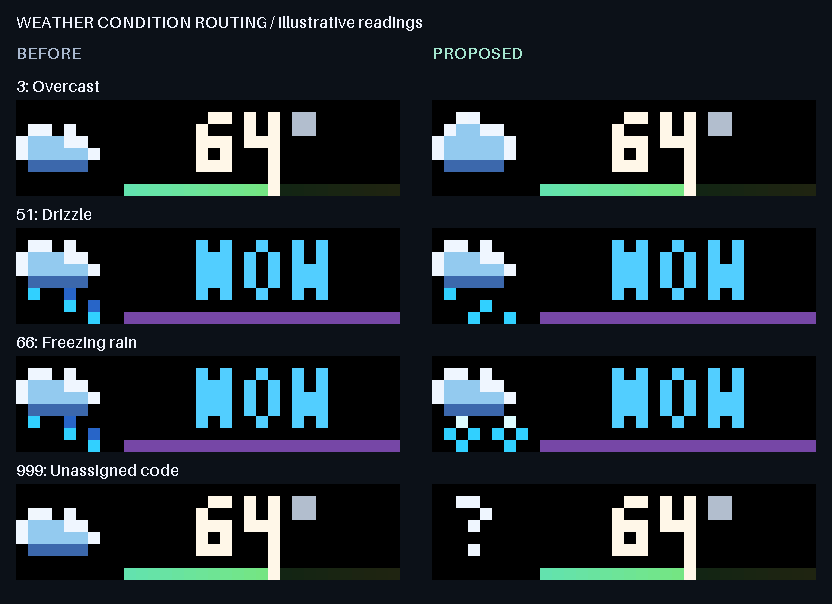

# Weather conditions from provider code to displayed page

The weather artwork already had drizzle and overcast designs, but production
routing collapsed them into rain and a generic cloud. Freezing rain/drizzle
also appeared as ordinary rain. Numeric ranges treated unassigned codes such
as 52 and 98 as real precipitation, and a negative code became partly cloudy.

This change maps exact code membership from the provider's
[documented WMO table](https://open-meteo.com/en/docs#weather_variable_documentation)
through the actual parser, scene selector and wire payload. The 29 documented
codes include heavy thunderstorm code 97. Related intensity variants share a
condition-family icon rather than claiming 29 distinct pictograms.

| Codes | Condition family |
| --- | --- |
| 0 | Clear, with day/night artwork |
| 1, 2 | Mainly clear / partly cloudy, with day/night artwork |
| 3 | Overcast |
| 45, 48 | Fog / rime fog |
| 51, 53, 55 | Drizzle |
| 56, 57, 66, 67 | Freezing drizzle / freezing rain |
| 61, 63, 65, 80, 81, 82 | Rain / rain showers |
| 71, 73, 75, 77, 85, 86 | Snow / snow grains / snow showers |
| 95, 96, 97, 99 | Thunderstorm, including hail variants |
| Values outside the documented provider set | Explicit unknown condition |

## Resulting behavior

Overcast and drizzle reach their existing reviewed sprites. Freezing liquid
precipitation uses a cold cloud and two hollow ice-shaped drops, with a bounded
glint following their edges. This symbol denotes freezing rain/drizzle; it is
not the retained rain/snow mixture (`sleet`) reference. Only one system moves,
and the hollow centres remain black in every pose and the low-light model.

An unassigned current code uses a steady question mark while retaining the
valid temperature. It does not invent a sky condition or report precipitation
NOW. A valid forecast can still select the existing precipitation countdown
independently of an unknown current condition.



A shared precipitation-family set protects all four decisions in current/forecast
selection. Drizzle and freezing precipitation retain current NOW behavior,
low-probability categorical forecast detection, exact returned timestamps and
ceiling-rounded minute ETA. The existing dry-current-interval safeguard remains.
The internal `kind="rain"` countdown contract is retained for compatibility.

Known-code numeric lanes, meter positions, metadata, duration/lifetime settings,
units and request cadence are unchanged. Twenty-one already-correct documented
conditions remain byte-exact across day/night and static/animated variants.
Unsupported 52/98 intentionally replace the old false NOW reading with the valid
temperature and an unknown symbol. Manual/legacy cloud and sleet references are
retained; freezing conditions are never classified as sleet.

## Review and verification

The [self-contained review](docs/weather-conditions/index.html) has 36 representative
current/forecast day/night comparisons, animation/static controls, 120 ms stepping,
changed-only filtering and low-light mode. The complete manifest covers **228
prepared cases**: 136 current-code variants and 92 forecast variants. All examples
use illustrative readings and code fixtures, not real local weather.

The [static sheet](docs/weather-conditions/condition-comparison.png) and
[low-light sheet](docs/weather-conditions/condition-low-light.png) cover the changed
families. The animation closes every featured loop over 5.76 seconds and uses an
exact 49-colour palette; encoded GIF frames and total timing are round-trip checked.
Low-light is the existing per-channel 174 threshold, not calibrated gamma or LED
diffusion. Browser interaction and physical legibility remain separate checks.

The sampled modern wire maximum is **1,912 bytes**, within the unchanged 2,048-byte
limit. Only opaque 8-by-8 icon GIFs animate; the 23-by-8 RGB888 lane stays static
and the separator stays black. Unknown is intentionally a single steady frame.

With the project Python environment activated:

```console
python -X utf8 weather_condition_review.py --output figures/weather-conditions
```

The baseline is frozen at `18c4ae6708fe71815ac22c25d4e21a35ca48b50a`.
Forecast fixtures were generated from that original Git source with HTTP blocked,
after reproducing all 136 initial baseline cases byte-for-byte. Metadata records
source/baseline and payload hashes, exact new wire bodies, routing, readings and
timing. The gallery retains full decoded RGB frames.

**141 new regression cases** cover every documented code through parsing, selection and
actual payload generation, all wet forecast types with exact ETA, unassigned
codes, freezing topology, complete NOW glyphs, byte-identical unaffected pages
and the dry-interval guard. The full suite passed **3,613 tests in 137.37 seconds**,
zero failures, errors or skips. An isolated built wheel passed 20 condition/motion
payload cases and a freezing-countdown case outside the checkout with HTTP
blocked and all three production modules matching source. CI results are recorded
in the pull request. No live weather setting, host release, task, resident script,
brightness or display power is changed by this implementation. Revised-symbol
preview approval and guarded motion-policy adoption remain; the overall overhaul
is active.
