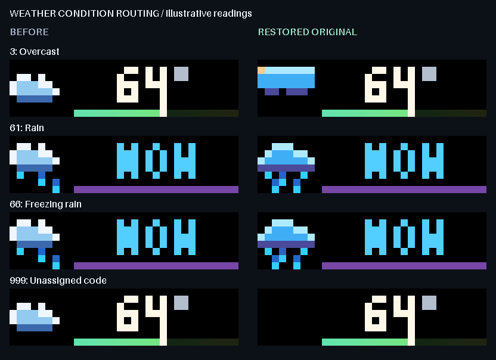

# Original weather animations and accurate condition routing

The weather candidate restores the actual pre-revamp animations from commit
`8f73bdc9ee5f1ee5a89ad9bd17e2bdbea271f8c4`, following the request to bring back
the old animations. Original cloud colours, silhouettes, moving crown highlights,
five-stream rain cycle, alternating bright drop heads and frame timing return.
Clear/day, moon/night, partly cloudy, fog, drizzle, snow, sleet and storm also
match that source frame-for-frame. This is a restoration, not newly drawn art.



The right-hand column is the restored original. The left is the pre-PR #25
candidate source at `18c4ae6708fe71815ac22c25d4e21a35ca48b50a`; both are synthetic
payload examples, not observations of the physical clock.

The rejected hollow-ice and question-mark symbols have been removed. Freezing
rain/drizzle retains its internal condition family and precipitation semantics,
but deliberately shares the original rain animation. The icon therefore does
not distinguish freezing liquid precipitation from ordinary rain. An unassigned
current condition leaves the icon area blank and retains the valid temperature;
it invents neither a sky condition nor a NOW precipitation reading. A valid
forecast can still select the existing countdown independently.

## Forecast and routing behavior

Exact membership in the provider's documented code table replaces broad numeric
ranges. Overcast and drizzle reach their original family artwork. Codes outside
the documented set, including 52 and 98, stop producing false precipitation.
Intensity and hail variants share family artwork; there are not 29 distinct icons.
The provider table and its source were verified in the initial routing review.

| Codes | Internal family / restored artwork |
| --- | --- |
| 0 | Clear, day/night |
| 1, 2 | Partly cloudy, day/night |
| 3 | Original full-width overcast |
| 45, 48 | Fog |
| 51, 53, 55 | Drizzle |
| 56, 57, 66, 67 | Freezing precipitation / original rain artwork |
| 61, 63, 65, 80, 81, 82 | Rain |
| 71, 73, 75, 77, 85, 86 | Snow |
| 95, 96, 97, 99 | Thunderstorm |
| Unassigned codes | Unknown / blank icon |

The shared precipitation-family set protects all four current/forecast decisions:
NOW behavior, low-probability categorical forecast detection, exact returned
timestamps, ceiling-rounded minute ETA and the dry-current-interval safeguard.
The internal `kind="rain"` countdown contract remains. Valid-code numeric lanes,
meters, units, metadata, request cadence and duration/lifetime remain protected.

## Review and verification

The [self-contained gallery](docs/weather-conditions/index.html) contains 36
representative current/forecast day/night comparisons, static fallback controls,
120 ms stepping and a low-light threshold view. The full manifest covers 228
prepared payload cases. Readings and provider inputs are illustrative fixtures.
Browser interaction and physical LED appearance remain unverified for this revision.

The featured GIF includes overcast, rain, freezing rain and unknown conditions.
It closes all featured loops over 5.76 seconds with an exact 53-colour palette;
every decoded RGB frame and total timing are round-trip checked. The static and
low-light sheets include drizzle too. Low-light applies the existing per-channel
174 threshold; it is not calibrated gamma or LED diffusion.

The sampled modern wire maximum remains **1,912 bytes**, under the unchanged
2,048-byte limit. Only the opaque 8-by-8 icon animates. The value lane remains
static and its separator remains black. Unknown is one steady blank frame.

`classic-frame-oracle.json` records independently captured frame hashes and delays
from the historical Git source for ten original families in both day/night modes.
It protects the restoration independently of current renderer output. Routing
checks cover all documented codes, wet forecasts, unknown conditions, exact ETA,
complete NOW glyphs and numeric-lane preservation. Artwork-specific assertions
now enforce the requested original behavior rather than the superseded redesign.

Regenerate with an activated project Python environment:

```console
python -X utf8 weather_condition_review.py --output figures/weather-conditions
```

The full suite passed **3,611 tests in 138.30 seconds**, with no failures, errors
or skips. The previous 3,613-test result belongs to the superseded ice/question-mark
candidate; its four ice-topology cases are replaced by two day/night rain-parity
cases. The user approved the restored original animation preview on October 31, 2026.
No live host, weather setting, scheduled task, resident script, brightness or
power state is changed by this revision. Guarded host/motion adoption still requires fresh verification; physical
acceptance is a separate step.
