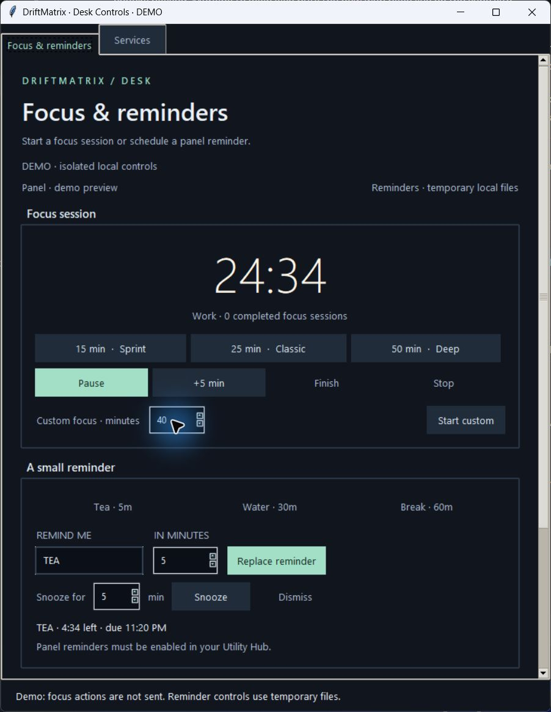
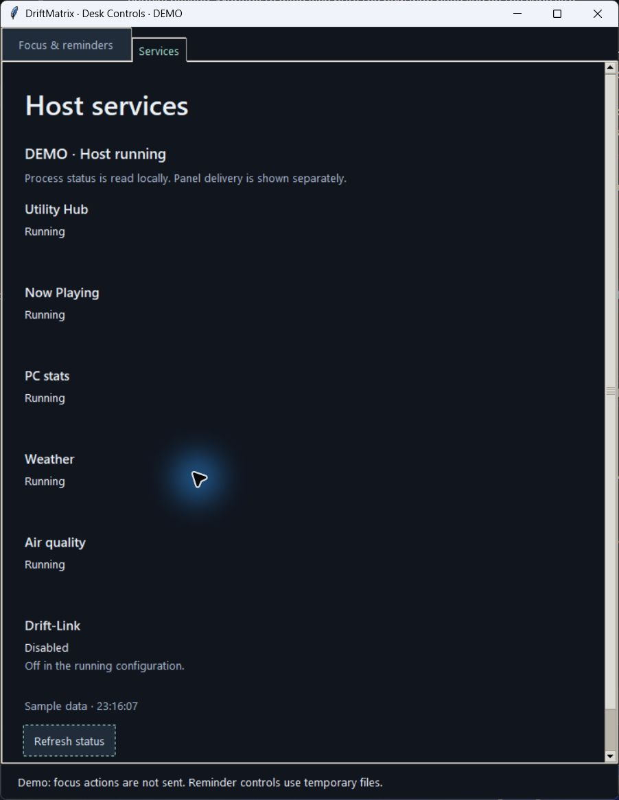

# Desk Controls

Desk Controls brings Focus, local reminders and supervised-service status into
one window. The existing Utility Hub handles panel delivery. All six worker
processes keep their existing lifecycle and transport safeguards.

Native Windows screenshots from the installed wheel's isolated demo:





## Open the window

From a checkout in PowerShell:

```powershell
python -m driftmatrix controls --config "$env:LOCALAPPDATA/AWTRIX/driftmatrix.json"
```

After installing the project, `driftmatrix controls` is also available. Without
an explicit target it reads the default canonical configuration, if present,
and uses its `runtime.data_dir` for every local file. An invalid canonical file
fails closed. When the default file is absent it retains the legacy local data
directory. To select legacy state explicitly:

```powershell
python desk_controls.py --data-dir 'C:/path/to/AWTRIX'
```

`--config`, `--data-dir` and `--demo` are mutually exclusive. Use your environment's
Python interpreter; the original Windows machine uses
`& C:/Users/devyn/anaconda3/python.exe` in place of `python`.

## Everyday controls

- Start a 15-, 25- or 50-minute session, or enter a custom 1–1440 minute duration.
  Pause changes to Resume for a paused timer; idle timers disable active-session
  actions. Focus requires fresh local timer status. Canonical mode also checks
  that the selected configuration enables Focus and matches the running host,
  with a live Utility Hub process.
- Select Tea, Water or Break, or enter a reminder label and duration. The local
  32×8 preview shows the label before scheduling. Snooze accepts 1–1440 minutes.
  Scheduling replaces the single current reminder; dismissal clears its local
  file for the Hub's next refresh.
- Successful custom durations, reminder settings and Keep on top are remembered
  in `desk_preferences.json`. Existing version-1 preferences gain defaults
  without being rewritten on open. Invalid input does not overwrite a reminder
  or the saved preferences. A preference-save failure is reported separately.
- Action feedback stays at the bottom of the window while either tab scrolls.
  Tab navigation, Ctrl+Tab between tabs and Enter in the custom-duration/reminder
  fields are supported.

## Command feedback and recovery

Focus queues one command at a time. The window confirms consumption from the
command ID in saved timer state. After 30 seconds it reports that the command is
still waiting and directs you to Services; it never automatically resends it.
If the queue entry disappears without a receipt, a newer fresh checkpoint allows
the window to recover with an explicit **unconfirmed** message. Check the timer
before sending another action.

The controller atomically saves each command's resulting state and consumed ID
before acknowledging its exact queue entry. Save/ack failures stop that batch,
so a long queue cannot evict a still-needed ID from the bounded replay history.
The next tick or a restarted controller can safely continue without applying an
already committed command again. This protects local command processing; a saved
receipt does not prove that the physical LEDs displayed the result.

## Services

The Services tab reads local supervisor records and checks process identities
every five seconds, or on Refresh status. It shows all six services, disabled
workers, restarts, stale status, configuration changes and restart-limit failures.
A dead worker is never described as running solely because a saved record says
RUNNING. The view does not start, stop or restart the host. Process status and
the Hub's panel-delivery indicator are distinct evidence.

If the selected file changes its panel URL or data folder while the window is
open, reopen Desk Controls before sending Focus actions. Configuration changes
are never silently adopted into another control queue.

## Isolated preview

```powershell
python -m driftmatrix controls --demo
```

Demo uses temporary files, a sample timer and clearly labeled sample service
status. Focus actions are not queued. Closing it removes only that temporary
state. Native visual checks use this mode so they do not alter the running host.

Native Windows layout, scrolling, input and tab switching were inspected. Linux
GUI tests run under the CI virtual display. Tk's accessibility tree does not
expose all native widget labels through the available Windows inspector;
screen-reader acceptance remains unverified.

Validation for this candidate: **2,837 tests passed in 61.07 seconds**, including
25 new cases. Regression checks cover configuration selection/retargeting,
disabled/stopped hosts, command receipt recovery, per-command persistence and
acknowledgement failures, a batch larger than replay history, old preferences,
invalid input, native action states, isolated demo operation and refresh cleanup.
The built wheel's 11 runtime modules and resources were imported outside the
checkout, and its native demo was exercised through the unified CLI.
